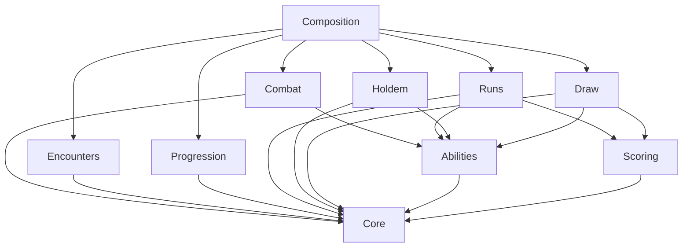

# PokerEngine

共享 C# 卡牌基础层，以及相互独立的德州、出牌计分和 Run 构筑模块。Unity 只负责宿主与表现；这些 Runtime 程序集均不引用 UnityEngine，不访问文件、网络或时钟。

生命战单位直接持有 Health/MaxHealth/Block，不依赖 ResourceState；玩家行动能量属于玩家玩法状态，筹码留在使用筹码的玩法中。公共战斗单位及最小牌型生命战见 [Combat README](Runtime/Combat/README.md)。当前 Draw/Run 仍按原分数目标推进；独立生命战已通过 Composition.CardDuelEngine 接入 [SingleBattle Demo](../SingleBattle/README.md)，完整 Run 结果账本尚未接入。

## 模块与依赖

```text
Assets/PokerEngine/Runtime/
├── Core/          PokerEngine.Core：ID、卡牌/牌区、资源、随机、标准牌组、牌型分类
├── Encounters/    PokerEngine.Encounters：通用战局配置、实例绑定、进度投影与终局摘要
├── Abilities/     PokerEngine.Abilities：内容目录、能力世界、执行/选择/知识/记忆
├── Combat/        PokerEngine.Combat：共用战斗单位、生命/格挡、原子伤害结算
├── Scoring/       PokerEngine.Scoring：加分、倍率、重触发、顺序与计分明细
├── Holdem/        PokerEngine.Holdem：座位、盲注、下注街、摊牌、底池、德州存档
├── Draw/          PokerEngine.Draw：抽牌、选牌、出牌/弃牌、积分目标、独立存档
├── Runs/          PokerEngine.Runs：持久构筑、关卡、奖励、商店、泛型 Run 存档
├── Progression/   PokerEngine.Progression：跨 Run 解锁、局外货币、永久升级、结算与存档
├── Composition/   PokerEngine.Composition：玩法适配器与可执行示例内容
└── link.xml       首包保留上述十个程序集
```



箭头表示程序集引用。每个模块有独立 asmdef；离线测试也按此依赖图分别编译 DLL。`Holdem` 不引用 `Draw/Scoring/Runs`，`Draw` 不引用 `Holdem/Runs`，`Runs` 不引用任一具体玩法，基础层不反向引用上层。跨模块组装只发生在 Composition。

公共命名空间继续使用 `PokerEngine`，类型实际分属上述程序集。原 `PokerEngine.Runtime` 与 `MatchEngine` 入口已移除；德州入口明确命名为 `HoldemMatchEngine`。原 `.meta` 随文件移动，已有资产文件 GUID 保留；旧空目录及其元数据一并清理。新增文件及目录均维护元数据；测试和 Editor 测试菜单不进入 Player。

| 职责 | 共享机制 | 模式拥有的政策 |
| --- | --- | --- |
| 卡牌 | 定义、实例、OriginId、牌区、随机洗牌 | 初始牌组、牌区形状、发牌/补牌时机 |
| 牌型 | PokerHandClassifier 识别 1–5 张的牌型及组成牌 | 德州从 5–7 张选最佳五张；Draw 使用玩家提交的 1–5 张 |
| 能力 | 条件、费用、效果、替换、选择、暂停恢复、预算 | 时机/动作键、参与者执行顺序、资源与牌区限制 |
| Combat | 战斗单位、生命、格挡、伤害/治疗事件 | 回合/控制器、牌型换伤害、胜负、Run 写回 |
| 计分 | 有序 Points/Multiplier 变换和明细 | 计分牌子集、何时计分、分数与胜负的关系 |
| Run | 构筑、金币、商品、成长、关卡和账本 | 具体关卡对局、合法行动、玩法存档校验 |
| Encounters | 通用配置、参与者槽位绑定、进度投影与各方终局结果 | 回合/卡牌规则、目标判定、结果生成与具体状态 |
| Progression | 跨 Run 解锁、货币、升级等级、幂等结算、统计和存档 | 解锁条件、奖励公式、升级效果、开局内容过滤 |
| 表现/网络 | 类型化命令和确定性结果 | 宿主认证、玩家视图、动画、I/O、请求收据 |

## 通用基础层

`CardDefinition` 为静态定义；`CardInstance` 为当前对局实体，`OriginId` 关联 Run 中的持久牌。复制牌产生新持久 ID 并继承强化，下一关重新创建实例牌。`StandardDeck` 提供标准 52 张牌，不依赖德州模块。

`CardInstance.Effects` 使用 `[Flags] CardEffects`：None=0、Enhanced=1<<0（强化）、Laminated=1<<1（塑封）、Ineffective=1<<2（失效）。不同效果可以共存；重复添加相同效果不会增加层数。强化/塑封在引擎中仍是语义标记，不自动赋予数值或材质；Unity 的 CardPresentation 模块负责将属性映射为火漆、镭射、失效压暗和禁用红叉，Core 不引用美术配置。已有 DrawCard/RunCard 的数值强化仍由对应模块管理，本轮不增加 Run 商店选项或跨关效果同步。

`IsDisabled` 独立于效果：卡牌层的 CanPlay / CanDiscard 都等于 !IsDisabled；CanScore 只受 Ineffective 影响。花色/点数继续从 DefinitionId 对应的 CardDefinition 获取。悬停、选中、观察者可见性和 Unity 颜色不进入 Core 卡牌或权威存档。

```csharp
// 不可变操作；返回的新实例牌由宿主写入下一份状态，身份/定义/OriginId 保持不变。
var next = card.AddEffects(CardEffects.Enhanced | CardEffects.Laminated);
next = next.AddEffects(CardEffects.Ineffective).WithDisabled(true);
next = next.RemoveEffects(CardEffects.Ineffective); // 强化/塑封保留，禁用仍生效
```

WithEffects / AddEffects / RemoveEffects / WithDisabled 返回新实例；未知位（含负数掩码）在构造和存档校验时拒绝。DeckEntry 可携带 Effects / IsDisabled，德州初始化和洗牌后重分配 ID 会保留这些属性。任意 CardZone 转移接口仍仅处理成员/顺序；Draw 的打出与丢弃命令统一检查所选牌的卡牌权限，在转移前原子拒绝包含禁用牌的请求。能力强制移牌不被这项玩家操作限制隐式禁止。

ScoringCard 携带 Effects。失效牌仍进入完整牌型判定，其逐牌点数、加分/加倍率/乘倍率、重触发及逐牌小丑计分都跳过；牌型基础分、等级和 BeforeCards / AfterCards 的整手效果照常结算。Draw 与 Holdem 的 Run 计分适配器均传递实例牌效果；两种玩法的牌型分类器不因失效而过滤卡牌。

`CardZone.Cards` 是唯一位置事实，Deck 最后一个元素为牌顶。牌区 Kind 使用稳定字符串：通用 `CardZoneKinds` 包含 Deck/Hand/Played/Discard/Removed；德州专属 HoleCards/Board/Burn 在 `HoldemZoneKinds`。基础层允许可选控制者，具体玩法校验控制者及区域数量，不把“两张底牌”写进共享模型。

ID 为区分大小写的非空字符串值类型；状态没有公开 setter，输入集合防御性复制。`Chips` 为带检查的非负 long，Energy 为非负整数，Health 可空；积分、下注筹码和商店金币没有隐式转换。

`HmacDeckShuffler` 使用版本化 HMAC-SHA256 计数器、拒绝采样和 Fisher–Yates；RandomState 保存秘密种子与计数器。相同输入产生相同输出，拒绝命令不消耗外部随机流。默认安全生成种子，`FromSeed` 供测试/回放。快照和随机状态只存在于权威端。

### 有序牌区操作

`Core/Cards/CardZoneOperations.cs` 提供 `CardZone` 扩展方法，可用于任意 Kind 的有序牌区。单区操作返回 `CardZone`；跨区操作返回 `CardZoneTransfer { Source, Target, Cards }`，其中 Cards 为实际转移顺序。原区域和输入集合均不修改，成功返回后由调用者将结果写入新的完整对局状态。

| 接口 | 语义 |
| --- | --- |
| `zone.Insert(index, card)` / `InsertRange(index, cards)` | 在 index 前插入；index 等于 Count 时追加，保留传入顺序 |
| `zone.Remove(card)` / `RemoveRange(cards)` | 按 ID 移除；所有指定牌必须存在，剩余牌保持相对顺序 |
| `zone.RemoveAt(index)` | 移除指定位置的牌 |
| `zone.Move(fromIndex, toIndex)` | 区域内移动一张牌，toIndex 是移动后的最终索引 |
| `zone.Swap(firstIndex, secondIndex)` | 交换两个位置 |
| `zone.Reorder(cards)` | 提交全量排列，必须恰好包含原有全部牌一次 |
| `zone.SortBySuit(resolveDefinition)` | 黑桃 → 红桃 → 梅花 → 方块，组内按 A、K、Q、J、10…2 |
| `zone.SortByRank(resolveDefinition)` | A、K、Q、J、10…2，同点数按黑桃 → 红桃 → 梅花 → 方块 |
| `source.TransferTo(target, card, targetIndex)` | 跨区转移一张牌到指定位置 |
| `source.TransferRangeTo(target, cards, targetIndex)` | 按传入顺序转移多张牌；来源中未选中的牌保持相对顺序 |
| `source.DrawTo(target, count, targetIndex)` | 从来源末尾依次取出 count 张，按抽取顺序插入目标区域 |

所有索引从 0 开始。插入/转移目标位置范围为 `[0, Count]`；Move/Swap/RemoveAt 为 `[0, Count)`。例如 `[A,B,C,D].Move(0,3)` 得到 `[B,C,D,A]`。从 `[A,B,C,D]` 抽取两张会返回 `[D,C]`，剩余 `[A,B]`。

```csharp
hand = hand.Move(0, hand.Cards.Count - 1);

var transfer = deck.DrawTo(hand, 2, hand.Cards.Count);
// 在同一次引擎命令内，将两个结果一起提交到新状态。
deck = transfer.Source;
hand = transfer.Target;
// transfer.Cards 可用于构造发牌事件；事件可见性仍由玩法/宿主过滤。

// Zone 仅持有实例牌 ID，由调用者从卡牌实例及内容目录解析固有花色/点数。
Func<CardInstanceId, CardDefinition> resolveDefinition = id => definitions[instances[id].DefinitionId];
hand = hand.SortBySuit(resolveDefinition);
hand = hand.SortByRank(resolveDefinition);
```

两种排序均为一次性操作，返回新的有序 Zone，不设置持续自动排序策略。A 固定排在 K 前，不受 A2345 的牌型判定规则影响；花色次序仅为排列约定，不代表玩法大小。相同花色/点数的不同实例牌保持原有相对顺序，不按 ID 或效果再次打散。解析器每张牌调用一次，可显式返回 null 表示无标准花色/点数的牌，这些牌按原顺序放在末尾；缺失定义等错误应抛出异常，整次排序不提交。排序保留 Zone 元数据及全部实例牌身份，不修改卡牌属性或消耗随机数；宿主提交新列表后由 View 消费重排。

空批次、零张抽牌和同位置移动/交换允许不改变状态，但仍校验参数。负数/越界、无效/重复 ID、移除缺失牌、抽牌不足、非全量重排、源目标同 ID 或两区已有重叠牌均抛出 `ArgumentException`（含其派生异常），不返回部分结果。区域 ID、Kind、ControllerId 保持不变。CardZone 构造时也检查本区 ID 有效且不重复；不同实例牌仍可使用相同牌面定义。

跨区操作会同时生成两个结果，但不替调用者提交状态。单独 Insert/Remove 仅编辑区域成员，不创建或销毁 CardInstance，也不检查第三个区域；宿主/玩法仍须验证全局“每张实例牌恰有一个位置”、实例存在性及自己的容量、归属、阶段规则。核心接口不是客户端直接修改权威状态的命令。

能力的移牌/抽牌/重排、德州轮流发底牌/烧牌/公共牌、Draw 出牌/弃牌/补牌都复用此层。洗牌继续使用 `IDeckShuffler`，可将其结果交给 Reorder 并一起保存新的 RandomState；有序列表操作本身不消耗随机数、不决定动画或 UI 选中状态。现有快照字段和 schema 无变化。

## 共用能力层

`AbilityContext.State` 是 `AbilityWorld`，不再是 MatchState。它只包含参与者及资源、牌/牌区、能力、状态、决策、知识，以及模式给出的 ScopeId、PhaseKey、CurrentActorId、能力窗口。参与者列表的顺序就是模式选择的执行顺序；德州适配器提供庄家起算的座位顺序，Draw 提供单玩家顺序。

`AbilityDefinition` 的窗口和 RequiredAction 是稳定字符串键。`HoldemTiming/HoldemActionKeys` 在德州模块，`DrawTimings` 在 Draw 模块；新增模式不用修改能力层枚举。模式负责验证这些键与自身实际阶段一致。

`AbilityRuntime` 注册代码，`AbilityExecutor` 执行相同的主动/触发/选择逻辑：

- `Triggers(world)`：优先级 → 参与者顺序 → AbilityInstance.Order → ID；每个窗口每个触发器只访问一次。
- `Activate(world, windowId, abilityId, actor)`：检查所有权与资格，支付修改后的费用，消耗次数与冷却，然后执行提案。
- `Select(world, decisionId, actor, keys, skip, timeout)`：从已保存步骤继续，恢复挂起的 ModeAction 决策，不重新扣除费用。
- 返回 `AbilityExecutionResult { World, Events }`，不写外部状态。模式在应用结果后再次验证自身规则；失败整个命令回滚。

支持移牌、抽牌、排序、资源、添加/消费状态、计数、知识和请求选择；牌面/费用修正、效果替换及强类型 `AbilityOutcomeHandler.For<T>` 结果修正复用同一套注册与排序。没有 object 效果载荷或反射调用行为。能力处理器必须纯粹、确定、无外部副作用。

一次提案最多 64 条，RequestSelection 必须是最后一项；每窗口最多 256 个实际效果步骤。ProcessedTriggers、StepsUsed、选择候选、Continuation 和 SuspendedDecision 进入快照。选择前已经执行的步骤不重放；`Resume` 重新验证目标并只规划后半段。费用不足的自动触发被跳过。

`MemoryScope.Round/Encounter`、`UsesThisRound/CooldownRounds` 与牌局阶段无关。`AbilityLifecycle.EndPhase/EndRound` 清理相应期限，`BeginRound` 重置每轮记忆和使用次数并递减冷却；具体玩法决定何时调用。状态期限使用 ScopeId/PhaseKey，TriggerCount 通过 ConsumeStatusEffect 显式消耗。

`AllowChipChanges`、`AllowCardChanges`、`AllowKnowledgeProjection` 是独立权限。知识包括历史 Snapshot 与绑定牌区的 TrackCardInZone；共享投影只给调用者可见的额外观察，不提供完整 PlayerView。底牌/牌库、候选实体映射、完整 AbilityWorld 均不能直接广播。

## 德州模块

`HoldemMatchEngine` 维持原标准无限注德州行为：2–10 人、盲注、四轮下注、全下、边池、未跟注退款、摊牌和平分余数、换庄、淘汰及下一手。加注规则包括短全下及累计短全下重开。

`StandardHoldem`：固定标准 52 张牌，无能力。`AbilityHoldem`：已注册能力和可重复牌面的自定义牌组，规则版本 2。两者固定两张底牌、五张公共牌及烧牌；自定义牌组至少满足底牌 + 8 张后续发牌，最多 512 张。效果完成后不得破坏牌区形状或耗尽剩余发牌量。

```csharp
var catalog = StandardHoldem.Catalog();
var engine = new HoldemMatchEngine(catalog);
// engine.Create(matchId, definition, table, participants, random, abilities)
// engine.Execute(state, BettingCommand / AbilityCommand, authenticatedActor)
// engine.ExecuteSystem(state, StartHandCommand / AdvanceWindowCommand / DecisionTimeoutCommand)
```

RaiseTo 表示本街累计目标；Call 也用于全下跟注。玩家命令匹配 Revision、DecisionId/WindowId 与认证身份；系统命令只由宿主提交。`GetLegalActions` 提供当前玩家可用行动和下注范围。

引擎在 BeforeHand、BeforeBettingAction、AfterBettingAction、AfterBoardDealt、BeforeShowdown、AfterHandSettled 打开窗口。系统推进至玩家决策；BeforeBettingAction 不能被 AdvanceWindow 跳过。结算先支付底池，关闭 AfterHandSettled 才淘汰零筹码玩家并判断整场结束。

`HoldemAbilityAdapter` 将德州状态投影成 AbilityWorld 并应用结果。筹码费用/效果仅限手间，BeforeHand 不能扣光活动玩家筹码。牌面与 HandEvaluation 修正发生在摊牌提交前，最终选中五张的有效牌面冻结到结算。手期限状态保留至下一次发牌清理，供旧 AppliedModifiers 引用；结算后处理器不能重复应用上一手临时修正。基础发牌不经过能力效果替换链。

`TransitionResult.EventsFor(viewer)` 筛选底牌/公开事件；完整 State 和未筛选 Events 是权威数据。MatchSnapshotCodec schema **v5** 校验结构、规则、内容及模式，4 MiB/100,000 对象上限；新增必填的卡牌 Effects / IsDisabled，旧 v1–v4 明确拒绝，无自动迁移。

## 出牌计分模块

`DrawEngine` 拥有独立 DrawState/DrawCommand/DrawDefinition，与德州没有程序集引用关系。规则可配置手牌上限、每关出牌次数、弃牌次数、单次选择 1–5 张及目标分数。

流程为：

```text
Ready → Play → BeforeScoring → 计分 → AfterScoring → Scored → Continue → Ready
           能力选择可暂停/读档恢复                  └→ Won / Lost
Ready → Discard → AfterDiscard → 补牌 → Ready
```

`Execute(state, command, authenticatedActor)` 提交 Play/Discard/ActivateAbility/SelectAbilityTargets/Continue。`ResolveTimeout` 是权威选择超时入口，玩家直接提交 Timeout 会被拒绝。Scored 是完整计分检查点，Continue 才补牌及开始下一轮，让 Run 先采集积分与成长。

牌型识别结果区分 SubmittedCards 和 ScoringCards。默认对子/三条/四条只计组成牌，高牌只计最高一张，其余踢脚牌不贡献点数；德州适配器仍计完整最佳五张。Draw 不自动回收弃牌，手牌和牌库都耗尽则失败。这是独立出牌计分基础模式，不宣称复刻某个商业游戏的完整规则。

Draw 使用相同 AbilityExecutor、选择状态、费用、修正与生命周期。计分前修改牌面，计分后触发效果；计分后选牌中途读档不会重复增加分数或再次扣除出牌次数。DrawSnapshotCodec schema **v2** 固定内容/玩法/计分版本，保存选择、随机、计分明细、阶段和卡牌 Effects / IsDisabled；旧 v1 明确拒绝。DrawCard.Card 与 AbilityWorld.Cards 中的卡牌属性必须一致。

## 计分模块

ScoreEngine 不知道下注、底池、胜者、商店或关卡。输入由模式明确选择：牌型、牌型等级、实际计分的 ScoringCard 子集、有序 ScoringJoker。

1. 从 ScoreProfile 取得牌型等级的基础分和基础倍率。
2. 按小丑槽位顺序执行 BeforeCards。
3. 逐张计分牌：点数 + 强化 → 卡牌加倍率/乘倍率 → 小丑 PerCard；重触发重复这一过程。
4. 按小丑顺序执行 AfterCards。
5. `Total = floor(Points × Multiplier)`，最后取整；long 分数、decimal 倍率，检查溢出。

支持零张到 512 张显式计分牌（零张可供纯基础分/小丑规则），最多 32 个小丑、每牌额外 8 次重触发、总计最多 1,024 步。花色/点数/牌型条件及等级/成长系数由 ScoreEffect 表达。

点数分 2–10 按点数、J/Q/K 为 10、A 为 11。`31 × (1+4) × 2 = 310` 与 `31 × (1×2+4) = 186` 不同，故小丑顺序属于持久构筑。每步保存来源、操作量及操作后值，供动画解释。`ScoreEngine.Validate` 重算 trace 验证存档内部一致性，不证明历史行为真实性。

### 单牌点数查询与悬停数据

`Scoring/CardScoreRules.cs` 提供纯 C# `GetBasePoints(Rank)` / `GetBasePoints(CardDefinition)`：2–10 按点数、J/Q/K 为 10、A 为 11。非法 Rank 或空定义直接拒绝。定义重载查询印刷牌面；如果能力改变了牌面，宿主应先解析有效 CardFace，再使用 `ScoringCard` 查询。规则归属 Scoring，通用 Core/CardInstance 不反向依赖计分模块。

`ScoringCard` 补充只读派生属性，UI 与 ScoreEngine 使用相同规则，无需先结算一手：

| 查询 | 含义 |
| --- | --- |
| `BasePoints` | 当前传入 CardFace 的基础点数 |
| `BonusPoints` | 已有的单牌额外点数 |
| `PointsPerTrigger` | 基础 + 额外点数，一次触发的名义点数，checked long 加法 |
| `CanScore` | 是否被失效状态禁止逐牌计分；不代表必然属于本手计分子集 |
| `BonusMultiplier / MultiplierFactor / Retriggers` | 已有倍率修正和额外重触发次数，可单独展示 |

失效牌仍返回原基础/额外/单次点数，CanScore 为 false。PointsPerTrigger 不含倍率、重复触发、小丑、牌型基础分，也不是“这张牌本次最终贡献”；实际贡献以 `ScoreResult.Steps` 为准。禁用控制能否提交，失效控制逐牌计分，两者继续分离。强化/塑封标记本身不产生隐含数值。PointsPerTrigger 溢出会抛出 OverflowException，BasePoints 与 BonusPoints 仍可单独读取；引擎保留先过滤失效、再计算数值的行为。

```csharp
long printedPoints = CardScoreRules.GetBasePoints(definition);

// drawCard 保存该牌的计分修正；effectiveFace 由玩法规则解析。
ScoringCard info = drawCard.WithFace(effectiveFace);
long basePoints = info.BasePoints;          // 例如 A = 11
long bonusPoints = info.BonusPoints;        // 例如 +20
long pointsPerTrigger = info.PointsPerTrigger; // 31，不含倍率或重触发
bool canScore = info.CanScore;              // 失效时 false，仍可显示 11 和 +20
```

未来悬停 UI 由宿主按 CardId 获取该牌及观察者获准查看的数据，构造/读取 ScoringCard；CardView 不计算分数，也不通过图集 ID 反推规则。当前补齐的是查询接口，未添加悬停面板或计分动画。ScoringCard 的派生属性不写入存档，既有 ScoreProfile、快照 schema 和计分结果语义不变；运行时文件与 .meta 继续归入 PokerEngine.Scoring 首包程序集。

是否只有德州获奖者计分、弃牌获胜给多少分，现放在 **HoldemEncounterSettings**。ScoreProfile 已移除 WinnersOnly/FoldWinPoints。默认示例值可以替换，改变语义必须升级对应版本。

## Run 与玩法组装

Run 负责牌组、小丑槽位/副本数、等级/成长、牌型等级、金币，以及楼层序列、每层统一节点与分支路线。状态、命令和事件通过泛型保持强类型，运行时不 switch 玩法，也不保存任意 JSON/object 代替状态。

### 完整 Run 与多楼层

Unity 策划工具位于独立 `Assets/RunFlow` 模块，菜单 `Poker > Run Flow Editor`。流程保存为 ScriptableObject `RunFlowAsset`，经 `BuildDefinition` / `BuildContent` 转换为本节纯 C# 模型后初始化一次 Run；GameCore 不引用 Unity 或编辑器，Run v4 进度快照与策划资产分开保存。编辑操作与初始化示例见 [RunFlow README](../RunFlow/README.md)。

一次完整肉鸽由有序 `RunDefinition.Floors` 组成，每个 `RunFloorDefinition` 独立保存 Id、Kind（Normal/Boss）和自己的 NodeTree。例如“三层 + Boss 层”对应四棵独立节点树：

```text
Run
├─ 第 1 层：NodeTree 1（普通 / 精英 / 奖励 / 商店分支）
├─ 第 2 层：NodeTree 2（独立分支）
├─ 第 3 层：NodeTree 3（独立分支）
└─ Boss 层：NodeTree 4（Boss 及最终奖励）
```

楼层按配置顺序推进；完成当前树中选定路线的终点后，保存该层路径和完成记录，再自动进入下一层的入口节点。只有最后一层终点完成后 Run 才变成 Completed；任意战斗失败立即变成 Failed，未来层保持未访问状态。层数可配置为 1–32，不写死四层。每层内部允许分支与汇合，NextNodeIds 只能指向同一层中的节点，跨层推进由 RunEngine 统一管理。

```csharp
var definition = new RunDefinition("run.floors.1", ScoreProfile.Default,
    new[] {
        new RunFloorDefinition("floor-1", firstTree),
        new RunFloorDefinition("floor-2", secondTree),
        new RunFloorDefinition("floor-3", thirdTree),
        new RunFloorDefinition("boss-floor", bossTree, RunFloorKind.Boss)
    }, shopPool, rewardPool);
// 可执行示例（两种玩法）：ExampleRunContent.CreateFourFloors(drawMode: true/false)
```

`state.FloorIndex` 是当前层的零基索引；`state.Floors` 保存所有层的 FloorId、Kind、Nodes 和 IsCompleted，`state.Nodes` 是当前层节点进度的便捷访问。之前的层必须全部完成，未来层必须未访问；存档会校验每一层的身份、图版本及指纹，未来层也提前固定。每层可重复使用相同节点 Id、Stage.Id，身份按楼层区分，计分仍使用跨层唯一的战斗索引。

金币、牌组、小丑、等级、成长和积分历史属于整局 Run，换层不重置；只有进入新的战斗节点才重置该战斗的分数、回合预算和模式状态。下一层若从商店或奖励开始，上一场冻结对局会继续保留，直到新战斗启动。`RunEncounterContext.Floor/FloorIndex` 指向当前或最近那场战斗所属的层，因此在跨层后的非战斗节点中可能不同于 `state.FloorIndex`。

旧的 stages 或单 NodeTree 构造仍可用，会包装为一个默认楼层。`RunDefinition.NodeTree` 仅用于单层配置，多层配置必须访问 `definition.Floors[index].NodeTree`；对多层配置读取该兼容属性会拒绝。

### 统一节点与 Node Tree

`RunNodeDefinition` 是所有节点的共同基类，保存 Id、Kind 与有序 NextNodeIds。节点配置不可变；一次完整肉鸽的共享构筑和当前节点进度由 RunState 持有。

| 节点配置 | 内容 |
| --- | --- |
| RunEncounterNodeDefinition | RunStageDefinition（目标分数、回合上限、通关金币、能量）；Kind 为 Encounter / Elite / Boss |
| RunRewardNodeDefinition | 选择一个奖励或跳过；可配置独立 OfferPool |
| RunShopNodeDefinition | 购买、出售、升级、刷新、排序和离开；可配置独立 OfferPool |

`RunNodeTree(version, entryNodeId, nodes)` 支持多后继分支和路径汇合，是有唯一入口的有向无环图。每层最多 500 个节点、100 个战斗节点；拒绝层内重复身份、重复连接、未知后继、自连接、循环和不可达节点。节点可以任意组合，奖励或商店可作为入口或终点；终点成功完成后结束本层，战斗失败则立即结束整局为 Failed。无需在未选择的分支中完成战斗。

完成节点后：无后继 → 下一层入口（最后一层则 Completed）；一个后继 → 自动进入；多个后继 → NodeChoice，等待玩家提交 ChooseNextNode。战斗只在完整计分检查点判定成功或失败；奖励选择/跳过即完成，商店通过 CompleteNode 离开。进入节点时只生成该节点的对局或报价，未选择的分支不消耗随机数、不发奖励、不记分。

```csharp
var tree = new RunNodeTree("route.1", "reward", new RunNodeDefinition[] {
    new RunRewardNodeDefinition("reward", new[] { "normal", "elite" }),
    new RunEncounterNodeDefinition("normal", new RunStageDefinition("normal", 200, 6), new[] { "shop" }),
    new RunEncounterNodeDefinition("elite", new RunStageDefinition("elite", 500, 6, clearGold: 10),
        new[] { "shop" }, RunNodeKind.Elite),
    new RunShopNodeDefinition("shop", new[] { "boss" }),
    new RunEncounterNodeDefinition("boss", new RunStageDefinition("boss", 1000, 8), kind: RunNodeKind.Boss)
});
var definition = new RunDefinition("run.route.1", ScoreProfile.Default, tree, shopPool, rewardPool);
```

`RunAction.StartRun` 由宿主通过 ExecuteSystem 启动入口节点；玩家在奖励节点提交 ChooseReward / SkipReward，在商店节点提交 CompleteNode，在 NodeChoice 中通过 `new RunCommand<DrawCommand>(id, state.Revision, RunAction.ChooseNextNode, nextNodeId: "elite")` 选择下一节点。`engine.GetAvailableNextNodes(state)` 返回当前可选的后继定义，非 NodeChoice 时返回空列表。所有玩家路线命令校验 Revision、认证身份、阶段和实际连接，拒绝时保持原状态与随机数。

每层的 Nodes 保存 TreeVersion、TreeFingerprint、CurrentNodeId、Path 与 CompletedNodeIds。Path 是该层实际进入顺序，CompletedNodeIds 是其中已完成的连续前缀；NodeChoice 中当前节点已经完成。`StageIndex` 是最近进入的战斗在全局内容列表中的位置（按楼层顺序拼接所有 EncounterNodes），不是路线深度，层内可能向较小索引移动；尚未进入任何战斗时为 -1。计分账本按各层实际访问的战斗校验，奖励/商店保留上一场冻结对局，后续构筑变化不重算历史分数。

`RunEncounterContext.Node` 将战斗节点身份、Kind、配置与后继传给模式适配器。普通、精英、Boss 目前共用对局机制，可以配置不同目标、预算和奖励；特殊 Boss 技能与策略需要在内容/适配器中继续实现。

旧的 `RunDefinition(... stages, ...)` 自动生成“战斗 → 奖励 → 商店 → 下一场战斗”的节点图，最后一个奖励为终点。原 StartEncounter 的初次启动及商店单一战斗后继路径继续可用；有分支的商店使用 CompleteNode 和 ChooseNextNode。`ExampleRunContent.CreateBranching(drawMode: true/false)` 提供普通/精英分支、精英专属奖励、商店汇合和最终 Boss 的两种模式组装示例。

```csharp
var content = ExampleRunContent.Create();
var adapter = new HoldemRunAdapter(ExampleRunContent.Runtime());
var engine = new RunEngine<HoldemEncounterState, MatchCommand, MatchEvent>(content, adapter);
var run = engine.Create("run-001", new ParticipantId("player"));
var started = engine.ExecuteSystem(run,
    new RunCommand<MatchCommand>("start", run.Revision, RunAction.StartEncounter));
if (!started.Accepted) throw new System.InvalidOperationException(started.Error.ToString());
run = started.State;
string json = RunSnapshotCodec<HoldemEncounterState>.Serialize(run, content, adapter);
run = RunSnapshotCodec<HoldemEncounterState>.Deserialize(json, content, adapter);
```

切换出牌计分只在组装层更换强类型 adapter：

```csharp
var content = ExampleRunContent.Create(drawMode: true);
var adapter = new DrawRunAdapter(ExampleRunContent.Runtime(drawMode: true));
var engine = new RunEngine<DrawState, DrawCommand, DrawEvent>(content, adapter);
var run = engine.Create("draw-run-001", new ParticipantId("player"));
```

`IRunEncounter<TState,TCommand,TEvent>` 包含 Create、Execute、Validate、ReadProgress、SyncBuild 和 FilterEvents；另有 Kind/RulesVersion/SchemaVersion/MinimumDeckSize。具体 adapter 放 Composition：

- HoldemRunAdapter：下注筹码/盲注/获奖计分策略属于自身 settings。HoldemEncounterState 保存 Match 和冻结的 LastScore。
- DrawRunAdapter：手牌上限/弃牌次数/最多选择数量属于自身 settings；关卡目标和出牌预算来自 RunStageDefinition。
- ReadProgress 返回随机状态、是否到达完整检查点、是否耗尽、冻结的本轮积分，以及可迁移的能力记忆。Run 按 Score.Id 只采集一次，然后增长构筑并 SyncBuild。

RunAction.PlayerEncounter/SystemEncounter 包装具体命令；玩家/系统权限由 adapter 转交模式引擎验证。商店购买、卖出、升级、排序及刷新仍使用普通 RunAction。删除牌的下限来自 adapter（默认德州 12，Draw 8），不再写死在 Run 中。起始牌组及其版本由 RunContent 显式注入。

下注筹码、商店金币和关卡积分独立。默认德州每关重新提供 1,000/1,000 筹码和配置能量，10/20 盲注；Run 不包含这些德州字段。能力 portable Memory 只迁移 Encounter counters，实体 marks 不跨对局。`build.level/build.growth` 从 RunJoker 的唯一事实注入，不当作另一份可迁移构筑存档。

```text
Preparing → 入口节点 → 完成 → 单后继：下一节点
                        ├→ 多后继：NodeChoice → 选择下一节点
                        └→ 无后继：下一层入口 / 最后层 Completed
            战斗失败 → Failed
```

只有未完成效果/选择全部关闭的 checkpoint 才能记分或离开关卡。达到积分目标发奖励金币，耗尽轮数或对局无法继续则失败。历史得分在进入奖励前冻结；商店卖小丑、改牌和后续成长不会重算旧得分。

RunSnapshotCodec<TState> schema **v4** 将当前楼层、每层节点路线及完成记录、构筑、当前具体玩法状态、报价、随机和积分账本一起保存，固定内容/Run/计分/起始牌组及玩法身份、规则和存档版本，并保存所有楼层的节点图版本与配置指纹。16 MiB/500,000 对象上限；旧 Run v1–v3 明确拒绝，无迁移器。反序列化后同时校验楼层身份/顺序、图身份、路径连接、完成顺序、已访问战斗的积分及注入 adapter 的模式状态；修改楼层顺序、任一层图连接、节点顺序或战斗配置即使沿用同一个版本也不能读取旧路径。

含旧 Match v4 / Draw v1 内层状态的 Run 存档也会被 EncounterSchemaVersion 校验拒绝。

## 宿主与未覆盖边界

所有引擎是纯状态转换：战斗与 Run 的一次命令成功返回新状态和递增 Revision，失败返回原引用及空事件。Progression 的结算/升级成功返回新状态，非法操作抛出异常且不修改原状态，同一结算重试返回已有状态。能力处理器和适配器属于受信任注册代码，不允许从客户端动态提供。

本地宿主持有状态；PvP 服务端应为每个对局串行处理并映射认证身份。Revision 是前置条件，持久化仍需单写者或 CAS。CommandId 没有持久去重收据；网络重试若要求返回第一次响应，由宿主在同一事务提交快照、请求收据和待发送事件。Run 与内嵌对局必须原子保存。

当前未实现完整 PlayerView、HTTP/WebSocket DTO、文件/数据库 I/O、网络投递、AI、完整玩法的场景接入或计分动画。卡牌渲染/动画应消费投影与事件，不反向驱动规则。节点分支与局外成长数据/结算已具备；地图生成/选路界面、Boss 策略、消耗品背包和局外成长场景界面/开局效果接入尚未实现。

结构合法不证明离线存档可信。schema/规则/内容版本的变化需要明确迁移策略，不能仅改版本号；本次升级没有尝试读取旧格式。

## 验证与首包

统一入口为 `测试面板`，界面为中文。编辑模式专项显示实际用例数量，实战验证要求对应玩法场景处于 Play，截图独立分页；全量回归收进折叠区，不自动执行。面板显示进度、通过/失败数量并可打开报告，编辑模式测试可停止；进入 Play 或脚本编译时停止剩余用例并释放重载锁。

ModuleBoundaryTests 检查真实程序集引用，防止基础层反向依赖、德州/Draw互相引用或 Run 引入具体模式。保留原德州规则/随机守恒/恢复测试，新增独立能力、牌型子集、Draw 存档/续执行、模式无关 Run 和跨玩法集成测试。

Unity Test Runner 可正常运行 EditMode；若当前场景有未保存修改，可用 `测试面板 > 编辑模式测试 > 更多模块 / 全量回归 > GameCore 全模块` 在当前 Editor 场景逐项执行同步 NUnit 方法，结果写入 `Library/PokerEngineTests/status.json` 与 `results.xml`。该轻量运行器不保存或替换场景，不支持协程/参数化/setup/teardown；遇到这些测试会拒绝，需改用完整 Test Runner。

PackagingTests 验证所有十个模块出现在 Player 编译列表、linker 保留和资源 GUID 唯一。具体本轮结果见根 CHANGELOG。本轮未进行完整 Player 或 IL2CPP 构建；目标平台仍须验证泛型 DataContract 序列化与 AOT 行为。

## 通用战局数据

独立 Encounters 模块仅引用 Core。EncounterDefinition 保存玩法/规则版本、目标、回合预算、参与者模板与特殊规则 ID；EncounterContext 保存本次 ID、实际参与者绑定和可选 Run/楼层/节点归属。EncounterSetup<TSettings> 保持玩法配置强类型，DrawRunAdapter.Describe / HoldemRunAdapter.Describe 可从真实 Run 输入生成对应描述。

EncounterProgress 是粗粒度进度投影，EncounterResult 是含各参与者胜负与结束原因的终局摘要。卡牌、牌区、资源、效果、随机与具体阶段仍由已有 DrawState / HoldemEncounterState 拥有；这些新对象不额外保存权威运行状态，不改变 IRunEncounter 的计分推进或既有快照 schema。数据结构、代码和后续接入边界见 [Encounters README](Runtime/Encounters/README.md)。

## 跨 Run 局外成长

`PlayerProgressionState` 是完整 Run 之外的玩家成长对象，包含玩家身份/Revision、成长规则版本/指纹、局外货币、类型化内容解锁、永久升级等级及幂等 Run 结算记录。统计由结算记录汇总，可按玩法查询；不保存本局卡牌或小丑实例。

静态 `ProgressionDefinition` 与策划地图、单局 RunDefinition 分开。`ProgressionEngine.Settle` 接受宿主解析后的结果/奖励，按 RunId 去重；`PurchaseUpgrade` 校验解锁、等级与货币后扣费。Composition 的 `RunProgressionSettlement.Create` 从经校验的 Run 提取终局摘要，不自动转移 Run 金币或构筑。

成长 JSON 为独立 `ProgressionSnapshotCodec` schema v1，Run 快照仍为 v4。宿主保存两者并原子处理终局结算/清除活动 Run；下一局由宿主解释升级效果及已解锁内容。完整数据图、代码和存档边界见 [Progression README](Runtime/Progression/README.md)。

## 共享卡牌对局数据与存档

Core 的 `CardTableState` 保存 MatchId、Revision、完整 CardInstance 注册表和所有有序 CardZone；全局身份不能重复，每张牌必须且只能属于一个已注册牌区。此层不包含德州下注或出牌计分回合规则，两种玩法通过各自引擎适配共享卡牌归属，不互相引用。

`CardTableSession` 提供 PrepareDraw / PreparePlay / PrepareDiscard / PrepareReorder 及玩法集成用 PrepareZones。Prepare 计算新不可变状态，Commit 只接受本会话且 Before 仍为当前状态的更新，防止旧命令或另一个会话重复消耗同一堆。出/弃按源列表顺序提交，禁用拒绝整批，失效仍可转移并保留 CanScore 语义。容量、Zone Kind、身份归属在提交前校验；PrepareZones 用于玩法替换相关牌区/牌属性，移除无归属的已删除实例，保留未受影响牌区。

`CardTableSnapshotCodec` 的独立 schema 1 保存完整卡牌状态，限制 16 MiB 严格 UTF-8，并在反序列化后验证所有归属和属性。存档可恢复为新的 Session 并继续命令；不包含 Unity 美术、观察者可见性、鼠标悬停或选中，也不改变原 Holdem/Draw/Run 存档格式。此快照包含隐藏牌，属于可信玩法/服务器存档，不能直接当作 PVP 观察者网络消息；网络仍需玩法层构建授权投影。

Unity 的 CardMatchHost 消费此基础层，运行时及编辑器围绕同一对局数据读取/操作；编辑器调试 API 使用 UNITY_EDITOR 宏，不进入 Player。新增 Core 类型沿现有 Core asmdef/link.xml 进入首包。

所有项目测试 asmdef（包括 CardPresentation.Tests.Support）显式限定 Editor，关闭 autoReferenced；Player 编译列表检查不包含任何项目测试程序集。测试面板及实战验证逻辑均留在 Tests/Editor。Tools 的旧离线辅助脚本位于 Unity Assets 之外，不参与游戏构建，也不作为编辑器面板的入口；日常改动只运行对应专项。
