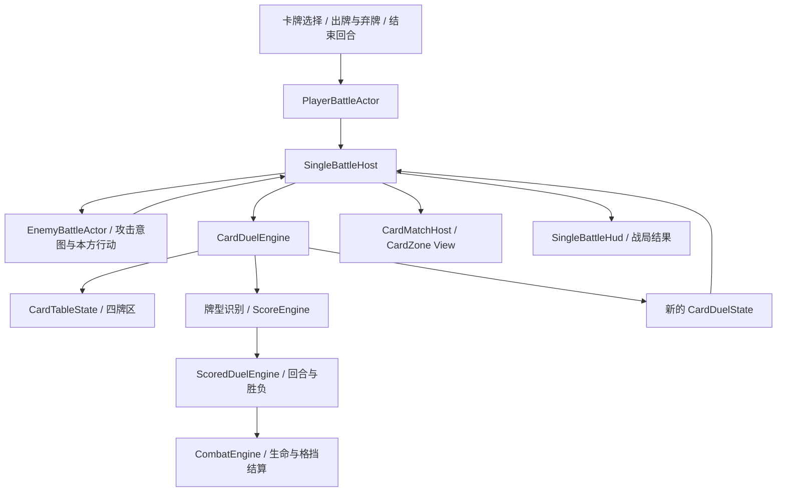

# 单局生命战 Demo

打开 `Assets/Scenes/SingleBattleDemo.unity`，点击 Unity Play。场景基于当时打开且包含未保存布局的 CardRenderingValidation 另存而来；原场景文件未覆盖。此处的“单局”是一场节点战斗，不是一整次多节点 Run。

## 当前可玩的规则

- 玩家 40 生命，守卫 75 生命；双方初始格挡为 0。玩家能量上限默认 3，初始能量独立设置、默认 3；出牌与弃牌消耗独立设置、默认各 1。怪物没有能量。
- 每场创建独立标准 52 张牌，不含物理 Joker。创建时洗牌，手牌为 0、抽牌堆为 52；进入首个玩家回合才免费自动发 8 张，抽牌堆剩 44 张。
- 点击卡牌选择 1–5 张，使用原有“出牌”按钮；用既有 PokerHandClassifier / ScoreEngine 计算真实牌型与参与计分的牌。
- 伤害为 `floor(牌型总分 / 5)`，经 CombatEngine 扣格挡与生命。原来的卡牌提示仍显示单牌基础点数，不能把它当作最终伤害。
- 玩家回合内可以多次行动，出牌/弃牌各自消耗对应配置；能量归零自动结束，也可点击“结束回合”主动放弃剩余能量。仅不足以出牌时保留剩余能量，仍可执行更便宜的弃牌或手动结束。敌人阶段展示“攻击 7”的意图并执行一次反击；击杀后不再反击。
- 默认出牌后不补牌。每次出牌的计分动画结束后，若仍处于玩家阶段，出牌区移入弃牌堆以接受下一手牌；最后一手牌在怪物行动后清理。怪物行动结束且战斗继续时恢复全部能量并补满 8 张，未打出的手牌保留。手牌打空但仍有能量时可手动结束回合。
- 整场允许 3 次弃牌，每次选 1–5 张后立刻补牌，按一次动作扣弃牌能量。弃牌耗尽能量也会进入敌人阶段；能量不足时不扣费、不耗次数、不移牌。开局发牌与回合/弃牌自动补牌免费。
- 抽牌堆不足时，先抽剩余牌，再将弃牌堆洗回并继续抽；手牌和出牌区不会参与洗回。卡牌始终属于唯一牌区。
- 玩家生命归零失败；第 8 回合玩家仍可先攻击，存活敌人反击后双方仍存活则回合耗尽失败。
- 终局锁定出牌/弃牌并显示胜负、原因、完成回合数和总分；“重新开始 / 再战一场”创建全新战局与 52 张牌。

数值位于场景 `Battle / Card Match / SingleBattleHost` 的 Inspector；这是验证流程的初始配置，尚未进行平衡设计。出牌/弃牌、排序、悬停提示、牌堆数字、点击牌库及飞行动画均复用现有组件。

能量设置为 `Max Energy`、`Initial Energy`、`Play Energy Cost`、`Discard Energy Cost` 四项。当前能量可超过名义上限，例如开局 5/3，花费后保留 4/3，不钳制到上限；上限同时是后续玩家回合的恢复目标，回合结束时剩余能量仍丢弃。初始能量可为 0，此时可手动空过；两项动作消耗必须为正，动作消耗也可大于上限。只读 PlayerTurnState 保存上限/当前值，不把能量放进共用 CombatantState。

场景只保留 View、输入与 UI 引用，CardMatchHost 开启 Runtime Managed，不保存验证用 initialZones、测试牌、牌区 ID 或牌库 roster。SingleBattleHost 创建完整空手战局，绑定其四区后执行一次 CardDuelAction.Start，再用已有飞牌动画投影首回合手牌；动画完成前锁定玩家操作。后续回合按策略发牌，发牌不扣能量或弃牌次数。牌区验证工具基于当前实战读取卡牌，只调整现有表现组件，不再维护测试牌或初始牌区。


`Hand Dealing` 提供 `Hand Size`（默认 8）、`Play Refill Timing`、`Discard Refill Timing`。两种动作分别可选 `After Action`（动作后立刻补到上限）或 `Next Player Turn`（回合打完、敌人行动结束后补到上限）；默认保留出牌后不补、弃牌后立刻补的行为。手牌上限与开局 0 张分开，开局 0 张不是把上限设为 0。动作后补出的牌使用现有发牌动画，在动画完成前不接受下一次输入；终局不再补牌。

纯逻辑接口为 `ICardDuelDealPolicy.GetDrawCount(CardDuelDealContext)`，通过 `CardDuelEngine` 构造参数注入。OpeningTurn / AfterPlay / AfterDiscard / PlayerTurnStart 共用只读上下文，策略只返回数量，引擎负责移牌、限制上限、牌堆不足时洗回和随机状态。内置 `CardDuelDealPolicy` 实现两种补满时机；固定抽 N 张已用自定义策略验证，目前不添加额外 Inspector 模式。清空剩余手牌、抽牌收费或禁止洗回属于后续规则扩展，需要另行定义，不能仅靠数量策略偷偷修改牌区。

## 一场战局的完整结构

```text
SingleBattleDemo.unity
├── Battle
│   ├── Card Match                   SingleBattleHost + CardMatchHost
│   └── Battle Actors
│       ├── Player / PlayerBattleActor
│       │   └── Model（VatBattleActorPresenter）/ FoxStatue_Collapse_VAT
│       └── Enemy / EnemyBattleActor
│           └── Model（VatBattleActorPresenter）/ DragonGargoyle
├── Card Table
│   ├── Hand Zone                    手牌 View / 输入 / PlayHost / TransferPresenter
│   └── Played Zone                  出牌区 View / PlayHost
├── Environment
│   ├── Lighting                     原有灯光
│   ├── TabletopCombat_Blockout       桌面
│   └── Markers / Enemy Anchor        保留的旧敌人定位点
├── Cameras
│   └── Main Camera / UI Camera      主相机与 UI 相机堆叠
└── UI
    ├── HandActionPanel               出牌、弃牌、两种排序
    ├── DrawPileIcon / DeckOverview   抽牌堆统计与完整牌库
    ├── Card Hover UI / Card UI EventSystem  单牌提示与 UI 输入
    └── Battle HUD / SingleBattleHud  双方生命、意图、回合、反馈、终局与重开

CardDuelEngine                       纯 C# 战局协调器（Composition）
└── CardDuelState                    整场战斗的唯一权威状态入口
    ├── Table : CardTableState
    │   ├── Cards                   本场卡牌实例 / OriginId
    │   └── Zones                   Deck / Hand / Played / Discard
    ├── Duel : ScoredDuelState
    │   ├── Combat : CombatState    玩家/怪物身份、生命、格挡
    │   ├── Phase                   玩家行动 / 怪物行动 / 胜 / 负
    │   ├── PlayerTurn              玩家能量上限 / 当前能量
    │   ├── Scores                  已结算牌型账本
    │   └── Actions / CompletedRounds 出牌、结束回合、怪物行动账本与完成回合数
    ├── HasStarted                  是否已进入首个玩家回合
    ├── Random                      洗牌随机状态
    └── DiscardsRemaining            整场剩余弃牌次数
```

`CardDuelState.Revision` 来自 Table，创建时为 0，每个成功的首回合发牌、出牌、弃牌、出牌区清理、主动结束回合、怪物行动都递增一次，用于输入去重。Duel 的 Revision 随出牌、弃牌、主动结束回合和怪物行动递增；Combat 的 Revision 只随公共效果结算递增；表现镜像又有自己的本地版本。这些版本不能互换，回合数独立记录，不等于得分次数或任一版本。

## 责任与调用方向



- **规则层**检查选牌必须来自当前手牌、数量合法、阶段正确、次数足够；自行计算分数，不接受 UI 提交的伤害或分数。成功后一次返回新的卡牌与生命战组合状态，失败保持原状态。
- **玩家组件**为 CardMatchHost 的 ICardMatchCommands 接收方，读取玩家能量、当前选择和行动许可，将出牌/弃牌/结束回合请求交给宿主。
- **怪物组件**从当前配置和状态生成 EnemyBattleIntent，决定本方固定攻击；宿主在怪物阶段调度它，再由统一引擎校验和结算。意图是派生数据，不另存伤害或生命。
- **单位层**只保存共同战斗数据，玩家和怪物均无 ResourceState。玩家能量由 ScoredDuelState.PlayerTurn 组合持有；CombatantState 仍只持有生命/格挡等共用数据，怪物没有能量。
- **宿主层**先提交逻辑出牌，再等待卡牌落位和角色表现协议完成；若能量尚可继续行动，清理本次出牌区后恢复输入；能量耗尽或点击结束回合时，等待敌人预备动作完成再提交怪物行动，等待攻击/受击/死亡完成后投影补牌、等待落位并恢复输入。播放期间拒绝重复命令。
- **表现层**可以改变本地理牌顺序和选择状态，不能绕过权威协调器改变牌区、生命或战局阶段。
- **结果层**复用 ScoredDuel 投影出的 EncounterResult，包含双方胜负、结束原因、回合数和最终战斗 Revision；Demo 用它展示终局，不发 Run 奖励。

## 当前阶段的边界

这是独立的一场生命战闭环；没有使用 DrawEngine 的积分目标来模拟击杀，也没有修改原 DrawBattle 场景行为。新场景移除了 DrawBattleHost，SingleBattleHost 拥有战局权威，PlayerBattleActor 接收这张桌面的玩家命令。

## 玩家与怪物的派生组件

```text
BattleActor（抽象 MonoBehaviour：身份绑定、最新单位读取、表现协议调用）
├── PlayerBattleActor（玩家输入、选择许可、能量读取、主动结束回合）
└── EnemyBattleActor（怪物意图、行动许可、固定攻击策略）
```

战局仍由 SingleBattleHost / CardDuelState 统一拥有，CardMatchHost 的命令接收方现在是 PlayerBattleActor。双方组件通过 ParticipantId 查找当前 CombatantState，**不缓存另一份生命、格挡或战局阶段**；共用数据类保持 sealed，玩家/怪物的职责差异在派生组件中实现。

进入 Play 或重新开始时，宿主先创建逻辑单位，再将双方组件绑定到对应槽位。玩家组件只能绑定 PlayerId，怪物组件只能绑定 EnemyId；不同战局/场景的绑定拒绝。每次重开重新绑定当前实例，旧怪物 ID 不会继续驱动模型。禁用玩家或怪物组件时，玩家输入会停止。

角色根物体只放逻辑控制/身份绑定组件，模型、Renderer、Animator/VAT 均放入 Model 子树。绑定拒绝把根物体自身作为模型；编辑器重挂载保持现有模型世界位置、材质和 VAT 组件。

公共基类保留 ActionPresented、DamagePresented、DeathPresented 观察事件，但不再执行模型位移、抖动、倒伏或计时，也不订阅 StateChanged 来提前播放死亡。英雄暂用 Model 子物体下的 FoxStatue_Collapse_VAT，怪物使用 DragonGargoyle；双方均连接到独立美术 prefab。Model 上各自挂 VatBattleActorPresenter：攻击使用 DOTween 前冲/回位，受击使用 DOTween Punch，死亡播放各自 VAT 并等待真实结束。场景 VAT 禁用开局自动播放，由战斗协议驱动；重开恢复进度 0，跳过死亡表现则同步到进度 1。角色逻辑根姿态不变。

美术资源位于 `Assets/Art/Models/Creatures/FoxStatue/VAT/FoxStatue_Collapse_VAT.prefab` 与 `Assets/Art/Models/Creatures/DragonGargoyle/VAT/DragonGargoyle_Collapse_VAT.prefab`，只包含网格、材质和 VAT 播放器，不绑定场景战局宿主。角色行为组件留在 Player / Enemy 逻辑根节点，便于更换模型或复用美术。场景 Dragon 原先连接的是 FBX 模型，现保留对象与组件引用及原有属性，转为独立 VAT prefab 实例。

## 可等待的表现协议

逻辑角色绑定任意实现 `IBattleActorPresentation` 的子物体组件，宿主通过角色调用协议，不依赖具体 Presenter 类型、动画名称或持续时间。协议只接收已结算的只读 `BattlePresentationCue`（PrepareAttack / Attack / Hit / Death、ActorId、可选 CombatEvent）；表现不获得战局命令权限。

| 调用 | 协议要求 |
| --- | --- |
| `Play(cue)` | 返回 `BattlePresentationOperation`；实际动作结束时调用 `Complete()`，中断/错误时调用 `Cancel()` / `Fail(error)`。 |
| `Synchronize(unit)` | 同步投影只读单位快照，例如生命分档裂纹；不播放动作、不修改生命、不阻塞流程。 |
| `Snap(cue)` | 同步显示最终姿态，用于不播放动画的执行或跳过；不能保留异步工作。 |
| `CancelPresentation()` | 停止旧协程/动画/回调；旧句柄不得再影响新绑定。 |
| `ResetPresentation()` | 取消旧表现并恢复初始姿态，用于新战局、重开和禁用。 |

操作句柄在 Unity 主线程使用，仅允许一次终态（Completed / Cancelled / Failed），迟到或重复完成返回 false。宿主等待句柄完成后才进入下一表现/流程检查点；不再用固定 scoreHoldSeconds / enemyTellSeconds 推测动作时长。PrepareAttack 的停留也由 Presenter 决定。双方可独立替换成 Animator、Timeline 或其他适配器；当前只提供基础变换和 VAT 实现。

## 当前石像表现方案

- 攻击：DOTween Sequence 前冲后回位。双方 Inspector 可独立调整 attackSeconds 和 attackOffset；默认玩家沿桌面 +X、怪物沿 -X 前冲 0.06。
- 受击：DOTween DOPunchPosition，独立配置 hitSeconds、hitPunch、hitVibrato。Tween 实际完成后才完成协议句柄；取消先停止 Tween 并取消句柄，重开恢复模型姿态。
- 生命变化：VatBattleActorPresenter 将只读快照交给 Model 上的 HealthCrackPresenter。在绑定、恢复和效果表现检查点同步；受击时瞬间跨档，治疗时可恢复档位，格挡不改变生命档位。
- 死亡：裂纹进入最低生命档，完整播放 VAT 的 0→1 时间线；使用播放器自身的结束状态，完成后才释放终局流程。

| 剩余生命比例 | 裂纹档位 | `_CrackProgress` | `_CrackDepth` |
| --- | --- | --- | --- |
| >75% | 0 | 0 | 0 |
| ≤75%、>50% | 1 | 0.35 | 原材质最大深度 ×0.35 |
| ≤50%、>25% | 2 | 0.7 | 原材质最大深度 ×0.7 |
| ≤25% | 3 | 1 | 原材质最大深度 |

`HealthCrackPresenter.stages` 可配置降序生命阈值、裂纹显现和深度倍数；没有逐帧插值。使用 Renderer 级 MaterialPropertyBlock 保留 `_VATProgress` 与其他属性，不实例化或修改共享材质。两种石像沿用各自材质最大深度，准备好的 VAT 网格保持单材质。纯规则层不依赖 DOTween 或 shader。

攻击、受击、死亡分别预留音效，Clip 默认全空。Model 下的 `Audio / BattleActorAudio` 持有三套 `BattleSoundSettings` 与 `Attack / Hit / Death` 子物体声源，可移动这些子物体调整发声位置。每个槽位保留 Clip、Volume、Pitch、DelaySeconds、SpatialBlend、MinDistance、MaxDistance；组件还保留可选 AudioMixerGroup 输出。默认不循环、不自动播放，空间衰减为 Linear，Doppler 为 0。

表现组件通过可选 `IBattlePresentationAudio` 调用音效，不把音频资源/声源放入 BattleActor 或规则层。每种动作使用独立声源，允许不同动作的尾音重叠；空 Clip 静默跳过，Snap/恢复不播放音效。音效不参与表现操作的完成判定，动画仍按实际结束推进流程；音效错误不阻断动作，取消、重开或禁用会停止声音及延迟播放。当前不接入全局音频管理器或自动加载占位音频，后续可替换音效实现。

当前播放顺序为：卡牌落位 → 攻击完成 → 受击完成 → 必要时死亡完成 → 收牌或敌人预备 → 敌人攻击/受击/死亡完成 → 补牌落位 → 释放输入/显示终局。当前是一对一顺序播放；没有命中时刻标记、并发群体演出或镜头编排。观察事件不承担等待职责，所有阻塞工作必须通过协议句柄完成。

**等待发生在 Unity 战局流程层。**纯规则引擎仍同步、确定性地产生并提交结果；已提交的生命/能量状态不因动画耗时而改变。表现期间拒绝新玩家命令，宿主延后敌人调度、收牌/补牌表现、输入释放与终局展示。若操作失败/取消，宿主记录异常并跳过剩余演出，同步到当前权威状态，不重复结算已提交伤害。显式 `SnapToState` 取消当前操作并完成待推进流程；禁用宿主时保留尚未提交的敌人阶段，恢复后继续。不会用任意超时提前推进，协议实现必须报告完成或失败。

`CardDuelEngine.Create` 可传入当前 `DeckEntry` 列表，保留 OriginId 并按当前构筑数量实例化，例如 53/51 张；当前 Demo 启动入口使用标准 52 张。这里支持标准牌面与卡牌效果标记，尚未接入 RunCard 的完整增强、Joker、能力选择或 Run 宿主。

组合状态目前只在内存中运行。**不要单独保存 ScoredDuelSnapshot 来恢复这个 Demo**：它不包含四牌区、洗牌状态和弃牌次数。完整 CardDuel 快照、跨节点生命/构筑写回、Run 结果账本与奖励结算是下一层工作。当前没有磁盘存档或中途续局按钮。

暂不提供完整敌人 AI、多怪物、状态效果调度、正式角色动画和数值平衡。场景默认不改 Build Settings，直接打开后 Play 即可；未进行完整 Player/IL2CPP 构建。

## 维护和验证

- `Poker > Single Battle > Configure Demo Scene`：只允许在专用 Demo 场景中执行，重建本 Demo 的 HUD 与宿主绑定并保存；不会修改共享 UI prefab。HUD 手工调整后不要执行此菜单覆盖自己的布局。
- `Poker > Single Battle > Connect Battle Actors`：在当前专用 Demo 中创建/复用玩家节点、创建/复用 Enemy 逻辑根节点，将当前可见的 Enemy 或 DragonGargoyle 模型移入 Model 子树（保持世界姿态），把怪物组件挂到逻辑根，连接双方与宿主并保存；保留现有 HUD、模型和布局。
- `Poker > Single Battle > Organize Demo Scene`：将已摆放的 Fox 接入玩家 Model，连接双方 VAT prefab，按五个根分组整理场景并保存；保留美术、UI 引用与世界姿态，可重复执行。角色连接和 HUD 配置菜单支持分组后的层级。
- `Poker > Single Battle > Prepare Runtime Card Zones`：清理本 Demo 的验证牌、初始牌区和 roster，保留手牌/出牌区 View、相机、牌堆锚点、模型和 UI；保存场景，运行时由战局提供四区。
- `Poker > Single Battle > Refresh Energy HUD`：仅更新能量标签为两行并保留所需高度，显示当前/上限和出牌/弃牌消耗；保存当前场景，不重建其他 HUD 或模型。
- `测试面板 > 实战验证 > 单战局发牌专项`：发牌专项检查，使用真实出牌/弃牌按钮和动画交叉验证两种时机，检查输入锁定与回合补满；只临时覆盖设置并恢复，报告 `Library/SingleBattleTests/dealing.json`。
- `测试面板 > 实战验证 > 单战局完整流程`：通过真实按钮事件及真实飞行动画验证弃牌、补牌、扣血、怪物阶段、重复输入锁定、牌库浏览、排序、胜利、失败、重开。测试包含能量扣除、同回合连续出牌、自动/主动/空过回合结束、单次反击及能量恢复；测试只临时覆盖运行时数值，结束恢复初始数值并开始新战局。报告位于 `Library/SingleBattleTests/play.json`。
- `Poker > Single Battle > Capture Game View`：Play 中截图到 `Library/SingleBattleTests/demo.png`。
- `CardDuelTests`：纯规则回归，含 52 张开局、四区守恒、出牌/反击、弃牌预算、非法输入、终局、确定性洗回及传入当前构筑。
- `测试面板 > 编辑模式测试 > 角色与表现协议`：在独立 PreviewScene 中验证角色槽位、命令所有权、最新快照读取、定向受击/死亡事件、禁用输入、重开身份与模型姿态复位，以及手动句柄逐阶段等待、死亡完成、取消旧回调和单次终态。

纯引擎所有权始终在 CardDuelState；Scene/.unity 保存的是宿主配置和表现绑定，不能当作正在进行中的战局存档。

## 卡牌美术接入

单牌 CardView 与 Canvas 总览共用 `Assets/CardArt/Profiles/StandardCardArt.asset`。Host 经 DeckOverviewPresenter 绑定手牌 Prefab 的配置，牌区只消费投影和管理动画；CardMatchHost 绑定玩法侧 CardStateArtBindings，按卡牌状态选择组合 ID；单牌渲染器只消费通用参数组合。Run DeckEntry 的效果与禁用进入 CardDuel 后保留，禁用牌不能出牌/弃牌。美术入口为 `卡牌美术 > Shader 参数组合`，支持实际实例对照预览及独立可控光源；玩法映射入口为 `玩法配置 > 卡牌状态美术映射`。
