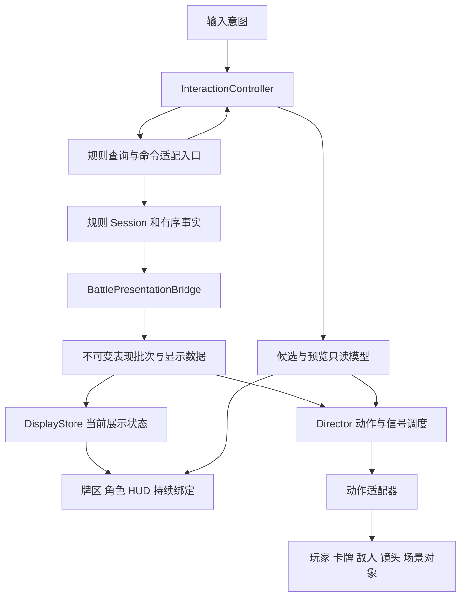

# 单局卡牌战斗表现系统设计

> **历史资料（2026-10-28 整理）**：本文保留旧版本的设计、配置或实施记录；下文“当前”“已完成”与测试结果均指记录当时。现行表现层接入统一以 [CardPresentation README](../Assets/Scripts/Presentation/CardPresentation/README.md) 为入口。旧 Scene3D / Minimal2D、CardMatchHost / CardZonePlayHost 及完整角色、HUD 配方不代表当前工程已恢复，不应直接按本文重建旧调用链。

设计日期：2026-10-18。状态：首版已落地，实际 API 与验证见 [实施记录](BattlePresentationImplementation.md)。基准场景：`Assets/Scenes/SingleBattleDemoNew.unity`。

本设计覆盖单局战斗的数据投影、表现接口、动作时间轴、预选切换、取消恢复，以及当前场景的迁移步骤。目标是同一份规则结果能够接入 2D、3D、即时显示或无画面实现；每个表现节点可以编排玩家、卡牌、敌人、UI、镜头和场景物体的任意受协议管理的动作。

表现层依赖稳定的只读数据协议。只有战斗适配器理解规则类型；具体动作与 UI 不持有规则执行器，不提交战斗命令，也不决定伤害、抽牌和回合推进。本文保留讨论时的设计命名；实际接口与命名映射以实施记录及代码为准。第十二节为迁移前基线，第十三节为已执行的迁移顺序。

## 一 目标与约束

### 必须满足的约定

1. 规则先原子结算到下一个玩家决策点或终局，再发布结果。任何表现等待、信号、取消和失败都不能再次执行规则。
2. 规则输出完整、有序、不可变的事实记录。画面动作可以重叠，持久展示数据的应用必须遵守事实顺序。
3. 全部显示组件共享当前展示时点。不能有组件读取最终权威结果，另一个组件仍读取前一步结果，却把二者作为同一时点发布。
4. 一个动作的中间信号可以启动其他动作；信号不等于动作完成。完成由真实实现报告，宿主不估算时长。
5. 预选属于持续可替换的本地交互状态，不进入权威事实历史，不作为无限等待的战斗演出。
6. 取消预选要释放自己的视觉贡献，并趋向最新合法目标；不能把过期快照写回新状态。
7. 接入已有战局、跳过动画和故障恢复都可直接对齐指定快照。恢复不会补播一次性音效、命中和开战触发。
8. 每个前端可以有自己的对象、动画工具和布局。公共协议不要求继承 `BattleActor`，不依赖 `Transform`、DOTween、VAT 或 Unity Timeline。

### 首版范围

首版完成规则事实、显示数据、动作与信号执行器、交互反馈作用域，以及当前 3D 场景和 Minimal2D 的接入。动作配置先采用可验证的列表与配方，支持顺序、并行、信号依赖和全部条件满足。

完整轨道编辑器、跨机器回放格式、网络预测、全 Run 奖励流程、任意图形脚本系统不在首版范围。当前战斗数值、随机消耗、洗牌边界、出弃牌费用和终局判定不因本改造改变。

## 二 分层与依赖方向



| 部分 | 唯一责任 | 不应承担的责任 |
| --- | --- | --- |
| 规则层 | 权威状态、合法性、结算、随机、规则事实 | 场景对象、动画时长、视觉信号 |
| `BattlePresentationBridge` | 事实翻译、可见性过滤、显示快照与变化、输入查询适配 | 自己推导伤害、具体画面动画 |
| `DisplayStore` | 保存已经应用的显示事实，原子发布显示更新 | 执行规则、决定演出配方 |
| `PresentationDirector` | 配方实例、依赖、信号、数据检查点、作用域和完成状态 | 计算牌型、选择规则目标、增减实际生命 |
| `InteractionController` | 选择与悬停、预览请求、候选状态、输入窗口 | 把预览结果提交为真实战斗结果 |
| 具体 View 与动作 | 对象实例、布局、动画、音效、材质、UI 插值 | 任意读取 Session 或修改显示事实 |
| 场景绑定 | 通过稳定角色和对象标识解析当前场景目标 | 决定参与者的规则属性 |

公共表现契约与调度核心使用纯 C#。战斗 Bridge 同时依赖规则与表现契约。Unity 适配层可以依赖 Unity 和相应动画工具，2D 与 3D 实现互不引用。

拟新增代码归属：

| 位置 | 内容 |
| --- | --- |
| `External/BattleToolkit/Engine/Runtime/Composition/Encounters` | 单局事实时间线及结算时记录 |
| `Assets/Scripts/Presentation/BattlePresentation/Runtime/Contracts` | 不依赖 Unity 和规则程序集的显示及动作协议 |
| `Assets/Scripts/Presentation/BattlePresentation/Runtime/Core` | 通用显示仓库、依赖调度、作用域 |
| `Assets/Scripts/Gameplay/SingleBattle/Presentation/Shared/Runtime` | 规则到显示的 Bridge、战斗预览适配 |
| `Assets/Scripts/Gameplay/SingleBattle/Presentation/Scene3D` | 现有对象、动作适配、场景配方与绑定 |
| `Assets/Scripts/Gameplay/SingleBattle/Presentation/Minimal2D` | 同协议的独立 2D 配方与 View |

程序集按依赖边界划分，不为每种动作创建程序集。规则代码属于 BattleToolkit 子模块，Unity 接入属于主工程；不复制第二份规则源码。

## 三 状态与版本归属

### 四种状态

| 状态 | 内容 | 维护者 |
| --- | --- | --- |
| `AuthorityState` | 已提交的真实生命、牌区、能量、状态、回合与随机状态 | `BattleSession` |
| `BattleDisplaySnapshot` | 当前展示游标对应的生命、牌区、阶段和其他公开数据 | `DisplayStore` |
| `InteractionSnapshot` | 当前观察者、悬停、选择、允许自由排列的本地顺序、候选结果 | `InteractionController` |
| 实际视觉状态 | 物体位置、动画进度、滚动数字当前值、飞行实例和临时覆盖 | 各 View 与动作适配器 |

例如规则已把敌人结算为 500 生命，而画面还未命中时，DisplayStore 保留此前生命。到合法的命中检查点应用该次结果后，HUD 的目标值变为 500，血条可以继续插值。插值中的数字不能成为规则、预览或其他组件的业务数据源。

### 身份与版本

| 字段 | 含义 |
| --- | --- |
| `BattleId` | 战局身份，重开产生新身份 |
| `RuleRevision` | 命令基于的权威版本，不能用牌桌镜像版本替代 |
| `BatchId` | 一次成功提交及其自动步骤的身份 |
| `Sequence` | 批次内全局事实序号，严格递增 |
| `DisplayVersion` | 显示仓库发布版本，并携带当前批次及事实游标 |
| `ObserverId` | 观察玩家或视角身份，决定可见内容及交互对象 |
| `SelectionVersion` | 本地选择与预览请求版本 |
| `PlaybackEpoch` | 播放或重新绑定的代次，取消、恢复、重开使旧代次失效 |
| `ActionInstanceId` | 一次具体动作实例，不等同于配方中的动作名称 |

`CombatRuleEvent.SequenceIndex` 仅在其规则上下文有效，不能直接作为整批时间线的全局顺序。数组下标、GameObject 地址、显示数字和卡牌面值都不能替代稳定身份。

## 四 完整有序的规则事实时间线

### 输出方式

在现有结果中新增 `BattleTimelineEntry` 及批次有序集合，作为额外的只读结算产物。迁移期间保留 `Steps / RuleEvents / Draws` 以兼容现有调用方。

`TeamBattleEngine` 在实际生命周期边界和效果处理位置记录事实；`CardDuelEngine` 在牌区移动、洗回和抽牌处记录卡牌事实；`BattleSession` 按实际执行顺序归并各步骤并分配批次序号。失败命令不对外发布部分时间线；预览生成的临时结果不推送到表现播放端。

记录器只观察，不增加 RNG 调用、不运行额外反应、不修改规则版本。现有 `CombatTimingEvent` 是规则时钟产物，有些无触发内容的边界会跳过时钟解析。新增稳定标记不能通过强制调用 `ResolveTiming` 实现。

### 节点与载荷

以下为目标语义，最终类名可在实现时调整；这些语义及相对顺序必须保持。

| 事实节点 | 必要内容与约定 |
| --- | --- |
| `BattleStarted` | 战局、阵容、初始公开快照；每次真实 Start 一次 |
| `PhaseStarted` | 玩家或敌方阶段、轮次、参与者；在该阶段开始效果之前记录 |
| `ActionStarted` | 已接受的动作种类、行动者、选牌及请求目标；表示开始结算，不保证真的攻击 |
| `ActionSkipped` | 被跳过的行动窗口、原因及相关状态；不能映射为普通攻击 |
| `HandEvaluated` | 牌型、变体、计分牌与正式计分结果 |
| `ActionCostSettled` | 正式费用及资源前后值；按当前真实结算位置记录 |
| `EffectSettled` | 伤害、治疗、格挡、消灭等结果，包含目标前后值与来源关系 |
| `StatusChanged` | 施加、阻止、刷新、消耗、到期等明确事实 |
| `RelicActivated` | 遗物实例、触发依据及结果关联；不作为再次执行遗物的指令 |
| `CardsMoved` | 具体卡牌身份、来源区、目标区及相应顺序变化 |
| `DeckRecycled` | 实际洗回边界与所属玩家；公开信息由 Bridge 过滤 |
| `CardsDealt` | 具体抽取身份、来源与目标、发牌原因及发生顺序 |
| `ActionResolved` | 当前动作的结算范围完成；不能仅按此判断可重新选牌 |
| `PhaseEnding` | 开始实际阶段末处理，后接周期效果和维护 |
| `PhaseEnded` | 该阶段实际收尾完成 |
| `PhaseClosed` | 因终局等原因关闭当前阶段，区分正常结束和提前关闭 |
| `BattleEnded` | 该批实际结算收尾完成后的胜负、原因和最终快照；真实终局一次 |

效果记录保留行动关联、效果来源、反应父子关系和各段身份。不能再通过“有 Damage 就是主动攻击”推导动作。效果事件若天然同时包含生命与格挡变化，应作为同一个不可分的显示变化。

`ActionStarted / ActionResolved` 描述规则动作范围，不能作为每次玩家能否操作的直接开关。有些费用结算或补牌在现有调用层次中的位置并不符合视觉直觉，记录时必须忠实保留实际位置，不能为了表格或演出重排结算。

### 四阶段与可交互窗口

```text
BattleStarted
  开战实际效果
PhaseStarted(player)
  首玩家阶段实际效果
CardsDealt(opening)
  规则推进到可决策状态，表现完成后打开本地预选

Play / Discard / EndTurn / SkipPlayerTurn 的实际事实
  费用、牌型、效果、反应、卡牌移动与补牌按真实顺序记录
  可以继续行动：该批表现完成后重新打开预选
  不能继续行动：进入实际阶段收尾

PhaseEnding(player)
  阶段末效果、状态维护
PhaseEnded(player)
PhaseStarted(enemy)
  逐个敌人的行动或跳过事实
PhaseEnding(enemy)
  阶段末效果、清盾和期限维护
PhaseEnded(enemy)

继续战斗：记录实际资源刷新、下一阶段开始及补牌
实际终局：记录必要的真实收尾及 PhaseClosed，最终 BattleEnded
```

这是节点覆盖示意，不是重新安排现有算法。发生提前终局时只记录实际经过的边界；不能补造本来不会执行的阶段末效果、敌方回合或补牌。开战效果直接结束战斗也必须有完整结果，且不能开放预选。

`InteractionReady` 是表现与输入系统的本地状态：权威已停在可决策点、显示已追上该决策状态、所需阻塞演出完成后才成立。它不属于随机或规则事实。出牌后返回预选不等于重新进入玩家阶段。

## 五 展示数据与单向数据流

### 显示模型

| 模型 | 必要字段 |
| --- | --- |
| `BattleDisplaySnapshot` | 战局与观察者、显示版本、事实游标、阶段、轮次、单位、牌区、资源、结果 |
| `CardZoneDisplayData` | 区域身份、所属观察角色、有序且只读的卡牌显示项 |
| `CardDisplayData` | 稳定 ViewId、允许公开的 CardId、可见牌面、美术键、公开属性、禁用信息 |
| `UnitDisplayData` | 稳定单位身份、显示生命上限与当前值、格挡、状态列表及期限信息 |
| `BattleDisplayChange` | 所属事实、前一事实游标、原子字段变化、适用观察者；不包含可执行规则 |
| `ActionAvailability` | 各操作是否可请求、完整预览是否接受、原因及对应规则版本 |
| `ActionPresentationContext` | 本次不可变行动者、目标、卡牌、效果及前后数据、语义配方键 |

公共 DTO 不含 `MonoBehaviour`、`Color`、材质资源、场景路径或规则引擎引用。ID、可见数值和语义键由中性契约表达，具体美术资源由前端解析。现有 `CardZoneViewData` 继续作为当前牌区组件的末端适配数据；它引用 Unity 和规则类型，不能直接宣称为新的公共中性契约。

Bridge 在交付数据前完成观察者可见性过滤。隐藏牌不向动作上下文泄露牌面或不应公开的规则身份；展示身份用于保持视觉连续。观察者切换需要取消旧交互与不再适用的绑定，并以新观察者快照重新对账。

### 显示仓库与数据检查点

只有显示仓库能应用 `BattleDisplayChange`。普通动作只发信号，导演根据配方中的数据检查点请求显示游标推进。每项事实最多应用一次，并检查战局、观察者、批次、前一事实游标与代次。DisplayVersion 只由仓库在发布时递增，不能作为 Bridge 预生成变化的逐事实前置条件，因为不同前端可能将不同数量的事实合并发布。

1. 信号到达后检查事实依赖与前置检查点。
2. 将连续且允许应用的变化原子提交到 DisplayStore。
3. 一次发布新的只读快照。
4. UI、牌区、角色同步目标值；依赖该检查点的后续表现获得执行资格。

有两条不同的顺序：**动作启动与完成允许重叠，持久显示事实只允许按游标顺序应用。** 某个后续信号提前到达时先记录，等其事实前置条件满足后再应用，不能跳过尚未展示的伤害或牌区变化。没有配置动画的事实也必须获得默认即时检查点，在前置事实满足后推进，不能悬空阻塞整批。

卡牌可以先做“提交卡牌”的视觉动作，再演攻击。若当前规则中真正移区记录晚于效果结算，这段提前飞行属于局部视觉过渡，不提前改写权威或持久显示牌区；实际归属仍在对应事实检查点提交。需要临时隐藏或禁止交互时使用过渡标记。不能仅为了让飞牌顺眼而重排规则事实。

### 牌区列表与实例

`CardList` 必须明确指哪一层。规则表决定真实身份与归属；显示仓库决定当前时点的牌区；View 按稳定 ViewId 对账具体实例。选择、悬停和允许自由排列的本地顺序属于独立覆盖，不改变规则敏感的抽牌顺序。

| 变化 | View 的处理 |
| --- | --- |
| 新增 | 复用或创建实例，按配方执行入场 |
| 移除 | 退出有效交互集合，必要时保留离场视觉实例 |
| 跨区 | 原子更新显示归属，按场景能力转移或重绑定同一身份 |
| 重新排序 | 保留身份与实例，仅修改布局目标 |
| 牌面或属性变化 | 更新资源与公开外观，不创建另一张逻辑牌 |
| 选中或悬停变化 | 更新交互覆盖，不改变持久牌区 |

离场残影不能计入有效牌数、继续接收选择或被当作另一张牌。对象池复用也受作用域代次约束，旧退场回调不能销毁已经用于新卡的对象。

### UI 的绑定

生命、格挡、阶段、牌堆数字、状态列表等读取同一展示快照。筹码倍率等候选信息读取当前候选模型。操作按钮读取统一的 ActionAvailability 与输入门禁；显示已追上决策状态后才允许提交，正式接受与否仍由规则决定。

数字滚动、条形插值和颜色过渡可以持续追随新目标，但其当前动画值不回流到数据层。同类型数据更新不需要重播整个表现阶段。候选类型、正式费用、预览效果和敌方意图等查询由适配层集中提供，UI 不分别调用引擎计算。

## 六 接口契约

以下 C# 是接口形状示意，不是可直接编译的补丁。上下文及 DTO 字段由前述表格定义，实现时补齐具体类型。操作生产者的完成与发信号能力不暴露给普通观察者。

### 规则接入边界

现有 `IBattleSessionPresentation` 的 `Initialize / Present / Synchronize / IsPresenting` 保留作为兼容边界，由 BattlePresentationBridge 实现。它把规则结果转为中性批次，再调用新前端。场景 Host 只负责生命周期、输入和绑定。

### 中性前端与动作

```csharp
public interface IBattlePresentationFrontend
{
    bool IsPresenting { get; }
    void Initialize(BattleDisplaySnapshot snapshot);
    IPresentationOperation Present(PresentationBatch batch, PlaybackMode mode);
    void Synchronize(BattleDisplaySnapshot snapshot);
}

public interface IPresentationAction
{
    ActionDescriptor Descriptor { get; }
    IPresentationOperation Play(ActionContext context, IMarkerSink markers);
    void Synchronize(ActionSyncContext context);
}

public interface IPresentationOperation
{
    PresentationStatus Status { get; }
    PresentationError Error { get; }
    event Action<PresentationStatus> Finished;
    void Cancel();
}

public interface IMarkerSink
{
    bool Emit(MarkerKey marker, MarkerPayload payload);
}
```

`ActionDescriptor` 声明支持的信号、目标能力、占用的视觉通道、能否中断及如何同步。`ActionContext` 包含固定的本次数据、目标解析入口和作用域身份，不含 Session、命令端或任意规则查询入口。动态数据查询不能偷读整批最终状态。

`PresentationStatus` 为 `Pending / Completed / Cancelled / Failed`。每个操作只允许一次终态；Cancel 必须停止后续输出并释放所有持有的工作，重复取消安全。完成和失败由实现报告，取消后迟到的完成、信号和数据写入无效。

Finished 是终态通知，不是唯一状态来源。Play 可能同步返回一个已经完成的操作；Director 订阅通知后还必须检查 Status，并按实例身份去重处理。Marker 通过预先创建的 IMarkerSink 接收，因此不会等待 Play 返回后才注册关键标记。配置资产只保存数据，每次运行使用独立动作实例或明确隔离的执行上下文，不能让两个批次共用一个可变 active 字段。

调度在单一执行上下文内排队处理；Unity 适配由主线程接收外部回调。同一次 Play 内先收到的 Marker 先于随后终态进入队列，但不在 Play 返回前递归启动后继。同步抛异常或返回空操作转为 Failed，并丢弃该次尚未消费的标记；合法的立即完成则依次处理已记录标记和终态。异步失败可能发生在后继已启动之后，此时取消整个关联组并同步，不能假装尚未发生过画面效果。

既有 `BattlePresentationOperation`、`CardActionViewOperation` 的完成机制由适配器包装。公共操作不是 `CustomYieldInstruction`；Unity 层可提供协程等待适配。牌区统一使用 `ICardZonePresentation` 接收展示快照；本地镜像由适配器在表现接受后提交，不向表现接口传入规则命令。

复用旧 Presenter 指复用视觉实现与完成机制，不是在中性上下文中暗藏 CombatEvent。迁移时为这些组件分离只接收显示 DTO 的新动作入口；需要保留的旧规则参数入口作为旧场景兼容适配。仅包装旧接口但仍让新动作读取规则对象，不能算完成解耦。

### 显示订阅与交互反馈

```csharp
public interface IDisplayReader
{
    BattleDisplaySnapshot Current { get; }
    event Action<DisplayUpdate> Changed;
}

public interface IInteractionFeedback
{
    void Reconcile(CandidatePresentationModel next, InteractionScope scope);
    void Release(InteractionScope scope, ReleaseMode mode);
}
```

写入显示状态的入口只给 Director 与 Bridge。持续反馈可以在内部实现 Enter、Update、Exit 配方，但对外以 Reconcile 最新目标为准，不要求逐条播完旧切换。

整个动作组和候选作用域都持有清理责任。Synchronize 是幂等的状态对齐，不等同于一次瞬时 Play；实现可以重建必要持久视觉，但不触发临时音效与镜头冲击。

## 七 动作时间轴与信号

### 配方组成

每个表现阶段映射一个动作组。初始能力为 `Action / Sequence / ParallelAll`，并允许动作启动条件引用同组其他动作的 Started、指定 Marker 或 Completed。底层对依赖做校验，首版编辑方式使用列表，不要求完整图形编辑器。

| 配置项 | 含义 |
| --- | --- |
| 动作键 | 当前配方中的稳定名称，运行时另分配 ActionInstanceId |
| 目标绑定 | 行动者、效果目标、选牌、指定牌区、主镜头或命名场景对象 |
| 实现与参数 | 具体动作适配器及其配置 |
| 启动条件 | 组进入、动作开始、指定 Marker、动作成功完成；多个条件默认 AllOf |
| 输出信号 | 声明的标记能力与载荷类型 |
| 阻塞属性 | 是否参与本组及批次的完成判定 |
| 控制通道 | 占用、叠加或接管哪些视觉属性 |
| 清理方式 | 取消、切换、恢复时的释放或同步策略 |

同一信号可以启动多个动作；一个动作可以等待多个条件。目标集合来自本次固定结果，不能让表现实现重新选择规则目标。缺失必需目标视为配置或运行失败；纯装饰目标可显式配置为可选，不能默认静默吞掉关键卡牌或命中。

### 出牌示例

```text
牌区     提交动画 ── Prepared ───────── Completed
                         │
玩家                     └─ 攻击 ── Impact ── 收招 ── Completed
                                       │
敌人                                   ├─ 受击 ── Completed
镜头                                   ├─ 震动 ── Completed
特效                                   └─ 命中 ── Completed
收牌     等待所需前序动作与事实条件 ── 收牌 ── Completed
```

| 动作 | 启动条件 | 数据与效果 |
| --- | --- | --- |
| `cards.submit` | 出牌表现组进入 | 只使用本次固定选牌，输出 Prepared |
| `actor.attack` | cards.submit 的 Prepared | 输出 Impact，攻击收尾可以继续 |
| 命中显示检查点 | Impact 且前序事实检查点完成 | 应用对应效果的显示变化，再发布快照 |
| `target.hit` | 命中显示检查点已应用 | 使用该次命中的结果 |
| `camera.shake`、`impact.fx` | 同一命中点及配方指定的数据前置条件 | 纯表现动作，可并行 |
| `cards.collect` | 所需动作完成且对应移区事实可应用 | 收牌；不能臆造新的牌区变化 |

图中间距不是固定秒数。动作可按秒、动画帧、Timeline 标记、Tween 子段或实际位置产生语义信号；跨对象衔接依赖声明的标记。显式延时可以作为艺术节奏配置，但不能冒充动画已经完成。

敌人受击与敌方回合攻击必须区别。玩家 Impact 只能启动该行动对应的反应；真正的敌人行动必须有该批规则事实。不能由动画信号创造一次敌人攻击。

### 信号运行语义

1. 先实例化配方、注册全部依赖，再启动任何动作。同步发出信号或立即完成也不能丢事件。
2. Director 保存本次动作已发生的标记，之后就绪的依赖仍可读取。后继通过调度队列启动，避免同步回调递归启动整个场景。
3. Marker 只放行后继；原动作仍可 Pending。Completed 才能满足成功完成依赖，Cancelled 和 Failed 都不能满足。
4. 信号地址包含 PlaybackEpoch、BatchId、组实例、动作实例和 MarkerKey。普通标记在一个实例内只接受一次；重复命中使用明确的子动作或带序号的 EffectId，不使用全局字符串 Hit。
5. 动作结束却没有发出被依赖的必需标记，判定失败并恢复，不能永久等待或自动推测命中。旧实现可以显式把 Completed 适配为所需 Marker。
6. 取消后整个作用域失效，未启动节点解除注册，在途工作取消。旧回调不能激活新战局、修改新数据或释放新对象。
7. 同时就绪动作按配置中的稳定顺序开始，随后并行。配置加载时检查循环、缺失引用、标记类型、目标能力与冲突通道。批次展开后还要合并动作启动、Marker、Completed、事实游标和数据检查点再检查环路，不能只验证动画轨道；运行前发现无法完成的组合则拒绝该配方并直接同步已提交结果。例如攻击等待晚于伤害的移区检查点，而伤害又等待攻击命中，就是必须拒绝的循环。
8. 首版信号依赖限于当前动作组；跨阶段用显式完成或数据检查点衔接，避免隐式跨批次广播。

### 组完成与控制权

所有应执行的阻塞动作，包括尚在等待合法信号的动作，都完成后，组才能完成。非阻塞装饰可不延迟输入，但必须有明确的生命周期和清理所有者；默认在组释放时清理。音效尾音若允许跨组持续，需显式移交给场景音频作用域。

并行动作允许作用于同一物体的不同通道，例如镜头基础构图与震动偏移。位置主控制、身体主动画等排他通道不能被无仲裁的两个动作同时写入。首版采用明确的排他、叠加和接管规则，不依赖回调先后碰运气。

## 八 预选与候选状态切换

### 候选模型

```text
CandidatePresentationModel
  ContextKey        BattleId、ObserverId、PlayerId、DecisionRevision
  SelectionVersion  选择及预览请求版本
  Mode              Closed、Empty、Valid、Invalid、Committing
  SelectedIds       当前合法选择集合
  ScoringIds        当前计分牌集合
  CandidateKey      牌型及需要区别表现的变体
  Points、Multiplier
  Availability      CanRequestPlay、CanRequestDiscard、原因和完整预览接受状态
  PlayPreview、DiscardPreview
  PreviewTargets、PreviewEffects
```

Valid 表示候选可识别，不代表出牌一定合法。有一对但能量不足时，继续显示一对及其计分，同时显示不能出牌的原因。规则预览是预测层，不覆盖真实或持久显示生命。

现有三种查询职责保留：`PreviewHand` 负责牌型计分；轻量 CanPlay、CanDiscard 负责基本预算和成员检查；完整 PreviewPlay、PreviewDiscard 验证完整效果。查询集中在适配入口，按相同上下文缓存，结果附带来源版本，不由各 UI 重复计算或互相覆盖。

### 状态转换

| 转换 | 约定 |
| --- | --- |
| Closed 到 Empty | 开放新决策窗口，清理上个窗口不再有效的选择 |
| Empty 到 Valid | 创建候选作用域，执行相应 Enter 反馈 |
| Valid 到同 CandidateKey | Update 数值、选牌差异、计分牌和目标集合；不重播全部入场 |
| Valid 到另一 CandidateKey | 取消旧的未触发工作，切换配方；共享对象尽量连续交接 |
| Valid 到 Empty | 释放候选覆盖，趋向最新基础显示目标 |
| 任意候选到 Invalid | 显示明确无效原因，移除不再成立的目标预测 |
| 快速 A 到 B 到 C | C 立即成为期望状态；不排队播放 A、B 的完整退出和进入 |
| 候选到 Committing | 冻结本次提交意图，暂停重复提交；不让异步旧预览改变本次上下文 |
| 提交接受 | 用已接受事实建立固定行动上下文，关闭预选并交接视觉控制权 |
| 提交拒绝 | 保留仍有效的选择，基于最新状态重算候选，显示原因 |
| 阶段失效、切换玩家、重开 | Closed，失效旧查询和全部交互作用域 |

预览请求即便当前同步实现，也应携带上下文键与选择版本。只有版本仍匹配的结果可以进入当前模型；以后换为异步查询不会让迟到的一对覆盖新的顺子。首版不要求预览异步化。

选择身份以集合变化判断，手牌自由排序不应被误判成另一套选择。数值、计分牌、目标集合等仍需独立判断 Update。卡牌移出、禁用或观察者变化后统一校验选择，不等待某个 UI 自己发现失效。

### 反馈生命周期与自然撤销

候选配方可配置 Enter、Update、Exit，运行器以最新 Reconcile 目标为准。Exit 可以淡出，但不能无限阻塞新选择。新状态可从当前可见姿态接续，旧退出回调只能处理自己仍持有的资源。

最终目标由以下来源组合：

```text
当前基础布局与外观
  + 当前有效的悬停和选择贡献
  + 当前候选配方贡献
  + 当前战斗演出拥有的覆盖或偏移
```

例：选中牌抬起后手牌排序发生变化，取消选择时应回到新的布局位置，而不是选中前缓存的位置。移除预览高亮也不能清掉卡牌强化颜色、敌人受击闪白或新的镜头构图。

每个反馈贡献持有作用域租约。释放只撤掉自己的贡献；排他通道交接到新动作后，旧 Exit 无权写回或重置该通道。连续数字可从当前插值值追向新目标，不能为了切换归零再重播。

### 提交交接

在关闭候选之前保存本次选择及已接受行动上下文，后续出牌动画不再读取可变的 SelectedIds。接受提交后，卡牌可以从当前抬起位置直接进入出牌动作。目标高亮可由行动作用域接管，避免先闪回默认再出现。

当前 `BattleSessionPlayback.Execute` 会在 Submit 返回之前同步调用 Present。因此交接不能写成“等 Submit 返回 Accepted，再清理候选”。输入入口在 Submit 前保存不可变意图并进入 Committing；Bridge 收到已接受批次后，必须在启动任何前端动作之前完成候选关闭和资源租约交接，再调用前端 Present。拒绝命令不会进入该分支，由输入入口恢复候选；成功返回后也不能再次清理或重复交接。开战和纯自动动作没有候选时，该步骤为空操作。

输入反馈与战斗播放使用不同作用域。候选高亮、数字滚动、呼吸动画不设置全局 IsPresenting。命令资格同时检查当前规则决策状态、显示是否追上、交互窗口及战斗阻塞工作；重开按钮和 HUD 采用相同的播放口径。

## 九 取消 恢复与绑定生命周期

### 不同操作的含义

| 操作 | 对数据的影响 | 对行为的影响 |
| --- | --- | --- |
| 用户取消选牌 | 更新本地交互，权威和持久显示事实不变 | 释放候选与选择贡献，平滑趋向最新目标 |
| 候选切换 | 替换最新候选模型 | 可中断、重定向、移交共享资源 |
| 单个阻塞动作失败 | 已提交规则不回滚 | 本组失败，取消兄弟及后继，进入恢复 |
| 批次取消或跳过 | 对齐已提交最终快照 | 失效全部旧动作，不把取消当完成 |
| 更换观察者 | 重新构造可见显示快照 | 清理旧交互和不再适用的对象绑定 |
| 重新开战 | 由正式 Host 创建新规则会话 | 旧代次完全失效，清理后 Initialize 新快照 |
| 接入已有战局 | 不重新 Start，不重复规则 | Initialize 显示当前状态，不自动重播历史 |

### 统一恢复顺序

1. 提升 PlaybackEpoch，关闭本地提交入口并立即使旧 Marker、回调和预览结果失效。
2. 取消全部阻塞动作、尚未触发依赖和相关交互作用域；释放通道租约。
3. 停止或回收过渡实例、临时粒子、延迟声音；仅释放当前作用域拥有的资源。
4. 原子替换为目标显示快照，重新对账卡牌、角色、状态和 HUD。
5. 调用各适配器的 Synchronize 或末端 Snap，建立持久视觉，不重放一次性信号。
6. 根据目标规则决策状态重新建立交互窗口，统一发布播放与输入状态。

清理需可重复调用。若恢复自身失败，应保留错误并保持输入关闭，不能在数据未对齐时宣称恢复成功。诊断记录批次、事实游标、动作实例和错误，不依赖任意超时假装完成。

### 任意行为的释放责任

| 行为 | 责任 |
| --- | --- |
| 位置、旋转、缩放 | 释放所属通道，依据当前有效组合计算新目标 |
| 材质与颜色覆盖 | 只移除自己的覆盖，不恢复整份旧材质快照 |
| 粒子和临时对象 | 明确停止、淡出、排空或回收策略 |
| 声音 | 可停止或淡出，已经发生的声音不能反向撤销 |
| 镜头控制 | 释放或显式交接，不能由旧回调抢回控制 |
| 延迟工作 | 取消注册并检查代次，禁止取消后继续输出 |

任意脚本行为无法自动推导正确逆操作。动作能够进入本系统的前提，是提供完成、取消和同步契约。不可逆的一次性反馈配置触发次数；同一候选普通 Update 不默认重复播入场音效。

### 即时播放与恢复同步

首版 Instant 使用专用即时路径，不调用普通动画 Play，不伪造其 Marker 或 Completed。它按序验证并把整批事实应用到显示草稿，默认一次发布最终快照，再同步必要的持久视觉，返回已完成的批次操作；失败不能发布半份草稿。

Synchronize 则停止整个旧依赖计划，直接替换指定快照，不遍历历史、不补发 Marker。两者都不播放瞬时音效和命中特效，也不能修改权威结果。以后若需要“快速但仍播放部分动作”的模式，应单独定义，不能改变 Instant 的含义。

需要在恢复后保留的镜头基准、环境阶段或对象外观，必须能由显示快照和配方重建，不能只存在于某次动画回调的副作用中。如果确实依赖已发生历史，由 Bridge 将所需事实投影成可恢复显示字段。

## 十 四阶段的目标接入流程

| 阶段 | 目标调用流程 |
| --- | --- |
| 开始战斗 | Initialize 初始显示 → 正式 Start 结算 → Bridge 转换完整批次 → 开局动作组及开战效果 → 发牌配方 → 等待所需工作 → 打开预选 |
| 玩家回合 | 选择意图 → 统一候选模型及 Reconcile → 提交 → 接受后退出交互 → 出牌或弃牌配方 → 效果及后续事实 → 能继续时恢复预选 |
| 回合结束与敌人回合 | 实际阶段边界配方 → 阶段末事实 → 敌方入场 → 各敌人正常或跳过配方 → 效果 → 敌方阶段收尾 → 下一决策点 |
| 战斗结束 | 剩余真实效果与死亡配方 → BattleEnded 对应的终局动作组 → 结果界面 → 允许正式重开 |

玩家、牌区、敌人、镜头、场景物体都通过目标绑定参与动作组。每个前端可选择不播放某类装饰，但其显示状态必须正确。治疗、状态、行动被跳过与遗物不能因为不属于伤害事件而丢失数据。

默认配方保持当前画面行为：旧出牌 View 仍可立即完成，弃牌保留真实离场等待，盾牌与模型保留各自效果。新增统一协议不要求同时重做美术。

## 十一 配置与验证边界

### 配置分工

| 配置 | 保存内容 |
| --- | --- |
| 规则 XML | 数值、牌型效果、状态、遗物、牌组、编成 |
| 表现配方 | 节点到动作组、语义标记、依赖、参数和通道策略 |
| 场景绑定 | 参与者与具体对象、牌区、镜头、场景控制器、美术资源 |
| 交互反馈配方 | 候选类型与变体、Enter/Update/Exit、一次性反馈重复策略 |

规则 XML 不增加动画名、GameObject 路径、镜头参数或等待秒数。表现配方不能写入伤害系数或重新判断牌型。数据变化由规则适配产生，艺术配置只决定如何表现及在哪个合法检查点交接。

### 必须覆盖的验收用例

| 类别 | 用例与通过条件 |
| --- | --- |
| 规则等价 | 相同初始种子及命令序列，改造前后规则结果、随机状态、费用与实际牌区一致 |
| 无条件边界 | 无遗物、无周期状态也输出实际开战和阶段边界，不增加规则反应或 RNG 消耗 |
| 开局特殊结果 | 开战增盾、治疗、状态、伤害和开战直接终局都能正确同步或表现 |
| 终局 | 主动伤害、状态、反应或轮数上限结束时只输出一次真实终局，无虚构后续阶段 |
| 卡牌顺序 | 标准抽牌、牌堆不足洗回、出牌与弃牌不同洗回边界均保留身份和顺序 |
| 效果语义 | 葫芦控制、同花治疗、三段伤害、反伤、DoT、状态免疫和行动跳过不被统统当作普通攻击 |
| 数据检查点 | 命中前后生命、格挡、状态及 HUD 一致；不能提前泄露后续伤害，显示变化不能重复应用 |
| 标记调度 | 同步发标记、即时完成、多依赖、同帧并行、缺失标记、重复标记均有确定结果 |
| 多段与多目标 | 各段和各目标身份独立，目标集合变化不串用上一段结果 |
| 快速预选 | Empty → 高牌 → 一对 → 三条 → Empty，连续快速切换只追随最新目标 |
| 同类更新 | 同为一对但牌、分数或目标变化时更新数据，不重复整套入场与音效 |
| 自然撤销 | 选中后排序再取消，回到新布局；移除候选不擦除强化、受击或新镜头状态 |
| 提交交接 | 接受后选牌上下文固定，拒绝后保留合法选择，旧预览不能覆盖新状态 |
| 异常恢复 | 动画中禁用对象、取消、失败、重开后旧回调无效，最终显示与权威一致 |
| 前端可替换 | 3D、Minimal2D、即时前端消费同一事实得到相同最终显示；纯规则可完全不创建前端 |
| 依赖边界 | 中性契约和调度不引用 Unity 或 PokerEngine，2D/3D 互不引用，规则不引用表现 |

测试按层开展：规则 NUnit 验证事实与结算等价；纯表现测试使用可手动推进的假动作验证信号和状态机；Unity 编辑及运行测试验证真实卡牌、VAT、HUD 和生命周期。禁止仅用测试替身通过来宣称当前场景已完成集成。

## 十二 当前实现与目标差异

下列路径相对仓库根目录，指向本设计对应的现有实现。

| 现有位置 | 当前情况 | 目标调整 |
| --- | --- | --- |
| [BattleSession](../External/BattleToolkit/Engine/Runtime/Composition/Encounters/BattleSession.cs) | 已原子结算自动步骤，只有步骤级聚合 | 新增完整有序事实，保持原子边界 |
| [TeamBattleEngine](../External/BattleToolkit/Engine/Runtime/Composition/Encounters/TeamBattleEngine.cs) | 有条件解析时机，阶段内多项结算合在结果中 | 实际位置无副作用记录生命周期与效果顺序 |
| [CardDuelEngine](../External/BattleToolkit/Engine/Runtime/Composition/Encounters/CardDuelEngine.cs) | 管牌区与补牌，Draws 与 RuleEvents 分离 | 记录具体卡牌与洗回事实，保留真实跨层顺序 |
| [BattleSessionPlayback](../External/BattleToolkit/Engine/Runtime/Composition/Encounters/BattleSessionPlayback.cs) | 已先提交再派发表现，支持同步恢复 | 保留职责，经 Bridge 接中性前端并统一完成状态 |
| [SingleBattleHost.Presentation](../Assets/Scripts/Gameplay/SingleBattle/Presentation/Scene3D/Runtime/Presentation/SingleBattleHost.Presentation.cs) | Start 直接投影最终牌桌；按 Damage 来源推攻击；只消费 Events；每个 EnemyAction 先准备攻击 | 移交 Director，完整消费事实，明确正常与跳过动作 |
| [SingleBattleHost](../Assets/Scripts/Gameplay/SingleBattle/Presentation/Scene3D/Runtime/Hosting/SingleBattleHost.cs) | 同时持有输入、场景和演出；公开 IsPresenting 与接口口径不同 | Host 保留装配输入；统一播放门禁 |
| [BattleActor](../Assets/Scripts/Gameplay/SingleBattle/Presentation/Scene3D/Runtime/Actors/BattleActor.cs) | 将少数效果映射成 Cue；治疗等通常只有同步；状态事件不在 Events 内 | 通过适配器消费明确动作与效果，不再靠伤害猜动作 |
| [IBattleActorPresentation](../Assets/Scripts/Gameplay/SingleBattle/Presentation/Scene3D/Runtime/Presentation/IBattleActorPresentation.cs) | 现有完成取消契约可复用，但属于 Unity 场景局部协议 | 包装为公共动作，不强迫其他前端实现旧协议 |
| [CardMatchHost](../Assets/Scripts/Presentation/CardMatch/Runtime/CardMatchHost.cs) | 已是受外部权威控制的展示镜像 | 迁移为统一显示仓库的牌桌投影，不新增第二个可写业务真相 |
| [CardZoneViewData](../Assets/Scripts/Presentation/CardPresentation/Runtime/Contracts/CardZoneViewData.cs) | 已有可见性过滤和稳定显示身份；仍引用规则及 Unity 类型 | 保留为末端兼容 DTO，中性显示模型由适配器转换 |
| [HandCandidatePresenter](../Assets/Scripts/Gameplay/SingleBattle/Presentation/Scene3D/Runtime/UI/HandCandidatePresenter.cs) | 轮询选牌并直接查询引擎，只有标签与数字更新 | 改为订阅统一候选模型，交互控制器管理生命周期 |
| [SingleBattleHud](../Assets/Scripts/Gameplay/SingleBattle/Presentation/Scene3D/Runtime/UI/SingleBattleHud.cs) | 直接读规则结构并查询费用，结果界面由 busy 控制 | 改为显示模型绑定，终局配方纳入完成管理 |
| [HUD 规则反馈](../Assets/Scripts/Gameplay/SingleBattle/Presentation/Scene3D/Runtime/UI/SingleBattleHud.RuleFeedback.cs) | 另外采集选择并查询出弃牌预览 | 复用同版本的候选与可执行性结果 |
| [CardInstanceView](../Assets/Scripts/Presentation/CardPresentation/Runtime/World/CardInstanceView.cs) | 已能保留当前交互偏移，朝新目标过渡 | 保留自然切换行为，增加作用域和通道交接 |
| [Battle2DView](../Assets/Scripts/Gameplay/SingleBattle/Presentation/Minimal2D/Runtime/Presentation/Battle2DView.cs) | 不引用 Scene3D，但仍直接解析规则状态与批次 | 改为消费同一中性显示协议，作为独立前端验收 |

当前 Host 在步骤开始时把 PresentedState 切到整步结果，而牌区在卡牌动作及批次末尾分次投影。新显示仓库需要替代这种隐式混合时点，避免以后加入命中标记后 HUD 提前读到后状态。

## 十三 当前场景的具体改造步骤

各步骤形成可独立检查的提交范围。迁移期间同一场战局只能启用一个事实投影写入者和一个演出导演；不能新旧流程同时播放或分别更新牌表。

### 步骤一 固定基线与数据契约

- 记录 `SingleBattleDemoNew` 的实际 XML 编成、玩家敌人绑定、牌区、HUD 与资源引用；以当前 `single-battle-new` 为默认验证入口。
- 在固定种子下保存开战、出牌、弃牌、主动结束、自动敌方回合与终局的规则基线。
- 定义时间线事实、显示 DTO、版本与操作结果；标明当前协议到新协议的映射。
- 保留场景对象、GUID、材质、数值和已有 MonoBehaviour 引用，新增组件通过明确绑定接入。

完成条件：规则顺序和数据拥有者有可测试基线，不需要改场景即可验证协议模型。

### 步骤二 在 BattleToolkit 补齐事实时间线

- 修改 TeamBattleEngine 的开战、行动、阶段和终局记录点，保留原时钟与反应判断。
- 修改 CardDuelEngine 的 Move、Deal 和洗回路径，记录实际卡牌身份与次序；不能仅补 DrawnCount。
- BattleSession 对成功批次归并事实，拒绝时不泄露部分输出；保留旧结果字段兼容。
- 补规则测试：无触发边界、开战终局、跳过行动、各类阶段末终局、洗回顺序与确定性。

完成条件：新事实包含完整实际过程，原权威结果与随机状态不变。

### 步骤三 建立 Bridge 与统一显示仓库

- 新增 BattlePresentationBridge，接现有 IBattleSessionPresentation；由它处理规则类型和可见性。
- 新增不可变显示快照、连续变化和原子发布，实现 Initialize、按游标应用与 Synchronize。
- 给当前 CardMatchHost 加显示适配，由统一仓库驱动镜像，明确本地交互数据暂存与迁移方式。
- 将相同观察者、事实游标与版本同时交给牌区、角色和 HUD；拒绝旧批次变化。

完成条件：即时前端不依赖动画即可正确显示全局数据；重复同步、切换观察者和跨牌区变化一致。

### 步骤四 建立动作导演与适配器

- 实现动作组、Signal 依赖、AllOf、阻塞判定、代次失效和通道租约。
- 使用 ICardZonePresentation 与 IBattleActorPresentation 的真实完成操作及声明的节点信号。
- 把卡牌提交、发牌、Actor、盾牌、HUD 结果显示分别接成动作或持久数据绑定。
- 提供镜头和命名场景对象的绑定入口；只有已配置能力才执行，默认配方不凭空改变场景美术。

完成条件：用假动作和现有真实动作均可验证中途触发、并行等待、失败和恢复，核心无 Unity 依赖。

### 步骤五 迁移当前场景的四阶段

- 从 SingleBattleHost.Presentation 提取旧演出责任到配方与 Director，Host 保留配置、输入和会话接入。
- 删除开战直接 Project 返回的特殊播放路径，开战效果、发牌和可能的终局都消费完整批次。
- 出弃牌使用固定接受上下文；效果按明确语义处理，补齐治疗、状态、遗物与跳过显示。
- 敌方准备仅在对应实际动作配方需要时执行，眩晕跳过采用独立配方。
- 终局 HUD 进入终局配方，等待所需死亡与收尾；统一 IsPresenting、按钮和重开门禁。
- 运行期间只保留一个显示提交路径，停用旧 Publish/Project 中承担相同责任的写入。

完成条件：默认编成和可选状态／遗物编成都完成四阶段，取消后不再执行敌人命令或丢开战效果。

### 步骤六 统一候选与 UI 数据

- 新增 InteractionController，将选牌、悬停、观察者和可操作窗口集中管理。
- 把 HandCandidatePresenter 与 HUD 规则反馈中的重复查询移入统一预览适配，产出 CandidatePresentationModel。
- 实现同类 Update、跨类切换、清空、拒绝恢复、接受交接和旧版本结果丢弃。
- 接入选择偏移、候选数字、目标高亮；镜头反馈按场景配方显式启用。
- 将 HUD 的生命、格挡、状态、回合、费用与计数改为读模型绑定，保留数字插值组件。

完成条件：快速选牌、排序后取消、能量不足仍显示牌型、提交与重开时的作用域交接均正确。

### 步骤七 验证可替换前端并整理配置

- Minimal2D 的规则解析迁到 Bridge，View 改收统一显示模型；不能只以“不引用 3D 程序集”作为解耦验收。
- 运行 3D、2D、即时与无画面规则的固定输入对照，检查最终状态和显示身份一致。
- 校验真实场景中的禁用、重开、多段与多目标、发牌洗回、缺失信号及取消恢复。
- 将稳定配方整理为可编辑资产和 Inspector 绑定，显示当前动作、等待信号、事实游标与输入状态。
- 验收后移除被替代的旧演出代码，更新模块 README 和测试入口，不改变其他玩法的行为。

完成条件：替换表现配方与对象绑定即可换风格，无需改规则；具体 UI 与动作实现不再查询规则引擎。

### 仓库交付边界

步骤二的规则实现与测试在 BattleToolkit 子模块交付，其余 Unity 接入在主工程交付。实际实施时分别保留提交范围，主工程固定已验证的子模块版本。文档编写本身不更新子模块指针、不修改运行代码和场景资产。

## 十四 首版完成判定

完成条件是：同一规则批次能被至少两种不同对象结构的前端消费；每个真实生命周期边界有稳定事实；显示数据有唯一归属；动作可依赖真实中途标记启动；预选可连续切换并释放自己的贡献；任意取消路径都能幂等对齐已提交状态。

接口形状、节点语义、状态转换和失败语义先由自动化测试固定，再增加编辑器便利功能。后续增加新物体或新动画工具，通常只需新增动作适配器与配方；增加新规则机制时，应先新增必要事实与中性数据，再由各前端选择对应反馈。
