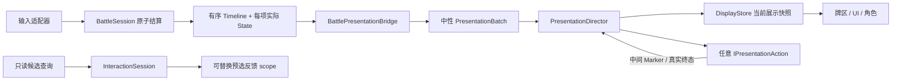

# 单局战斗表现系统实施记录

日期：2026-10-18。对应 [设计文档](BattlePresentationDesign.md)。接入场景：`Assets/Scenes/SingleBattleDemoNew.unity`，保留 XML 编成 `single-battle-new`、现有角色、美术、牌区、HUD 与相机。

## 已落地的边界

- `External/BattleToolkit/Engine` 增加不可变事实时间线，不调用动画、不等待信号。命令仍一次性结算到下个决策点或终局；不新增规则时钟、不额外触发状态、不改变洗牌或随机数消耗。
- `Assets/Scripts/Presentation/BattlePresentation/Runtime` 的 `BattlePresentation.Runtime` 不引用 Unity 或 PokerEngine。2D、3D 和无动画实现共享这一组契约。
- `Assets/Scripts/Gameplay/SingleBattle/Presentation/Shared` 负责规则投影、可见性、中文状态/意图文本、只读预选查询及旧会话接口的桥接。
- `Scene3D` 和 `Minimal2D` 各自使用同一 Director/DisplayStore。具体动作只接收中性 DTO；命令由 Host/input adapter 提交。旧规则类型 Actor 接口保留为兼容入口，新的播放路径使用 `PresentDisplay / SynchronizeDisplay`。
- 当前场景 Host 已移除 `BuildPlan` 及默认动作协程。运行时只加载场景序列化的 `ScenePresentationDirector.timeline`；缺少有效配置会在开战前明确报错。`BattlePresentationSceneSetup` 是编辑器配方生成工具，生成结果保存到场景，不参与运行时排序。
- Unity 动作统一派生 `PresentationActionBehaviour`。Actor、手牌准备、手牌收尾、Transform、UI 浮字使用同一基础契约、取消范围和可注入协程时钟；具体表现可以替换，规则层保持不变。

## 分步改造

| 步骤 | 实际实现 | 验证重点 |
| --- | --- | --- |
| 1. 规则节点 | `BattleTimelineEntry`、`CardDuelTransition.Timeline`、`BattleSessionResult.Timeline` | 真正执行点记录；阶段开始/结束/提前关闭；开局致死；状态、遗物、逐效果和真实移牌身份；拒绝不发布 |
| 2. 数据接口 | `BattleDisplaySnapshot`、`BattleDisplayChange`、`PresentationBatch`、`BattleDisplayProjector` | 前后快照、单位/资源/牌区/文本；CardId与ViewId；隐藏牌投影；连续游标；快照末项与权威结果一致 |
| 3. 表现调度 | `PresentationDirector`、`DisplayStore`、`ScenePresentationDirector` | Started/Marker/Completed、AllOf、同步信号锁存、跨事实重叠、缺失信号与失败恢复 |
| 4. 预选 | `BattleInteractionQueries`、`InteractionSession`、`SceneCandidateFeedback` | 识别与合法性分离；同型更新、跨型替换、清空、提交闭合、过时结果丢弃、资源通道归属 |
| 5. 场景接入 | 现有 HandZoneView、Actor/Coordinator/VAT/Shield、HUD/Candidate；保存 Director/feedback router 到场景 | 实际牌区和角色动画、数据对齐、输入门禁、取消、重开及原玩法回归 |
| 6. 完整配置化 | 序列化节点/依赖/检查点、效果与目标筛选、Actor/牌区动作适配器、镜头动作和 UI 动画 | Host 无默认动作序列；同一组件可服务多个 Actor；筛选后依赖完整；场景配方与真实信号运行 |

规则事实使用 `ActionResolved` 表示本条规则命令的完整收尾；它与表现动作句柄的 `Completed` 是两件事。展示顺序使用 `Sequence / DisplayCursor`，不能用可能重复的规则 Revision 代替。

## 当前场景时间线

本节描述已保存到 `SingleBattleDemoNew` 的配方。可操作的 Inspector 字段、筛选表和逐节点示例见 [时间线配置教程](BattlePresentationTimelineConfiguration.md)。

1. **开战**：Initialize 显示未发牌快照。`BattleStarted`、`PhaseStarted` 分别驱动开战/阶段 UI；首个可见帧的 `Revealed` 放行对应事实。`CardsDealt` 发布真实牌表并等待实际发牌/理牌过渡。
2. **预选**：交互层只读预测。Candidate 保留 Closed/Empty/Invalid/Valid/Committing、选牌身份、筹码、decimal 倍率、牌型和独立的 CanPlay/CanDiscard。场景 UI 不直接查询规则引擎。
3. **出牌开始**：`ActionStarted / Play / skipped=False` 配置 `cards → ReadyToAttack → attack → Impact`。`ui-play` 也在 `cards.ReadyToAttack` 后显示。准备动作只叠加临时偏移，真实 CardList 等移牌事实才变化。攻击 `Impact` 满足本事实 checkpoint，角色可以继续收招。
4. **出牌数据**：随后按规则事实顺序显示判型、费用、状态、遗物等。`HandEvaluated / Play` 和 `ActionCostSettled / Play` 配有独立 UI 动作，checkpoint 使用各自动作的 `Revealed`。具体事实以实际结算结果为准，不在表现层补造规则步骤。
5. **效果**：`EffectSettled` 按实际扣血、吸收格挡、格挡增减筛选 Hit/BlockHit/GainBlock/ClearBlock；`effect.Revealed` 表示目标真正开始反应。死亡节点在实际 `isDeath=True` 时加入，等反应完成再开始；没有前置反应的死亡有独立配方。同一 Actor 按自身忙碌状态排队，不同 Actor 可以重叠。
6. **镜头与 UI**：敌方实际受伤或吸收格挡时，`camera-impact` 在 `effect.Revealed` 后播放两段轻微旋转并复位；相应浮字同时开始。该配方 checkpoint 同时等待 `effect.Revealed` 与 `camera-impact.Completed`，避免连续效果抢占同一镜头变换通道。基础 HUD 数值在 checkpoint 发布快照时更新，浮字是独立动作。玩家/敌人的浮字分别使用左/右模板。治疗只匹配实际回血，不显示满血治疗的 `+0`。
7. **移牌/发牌**：`CardsMoved / CardsDealt / DeckRecycled` 使用空 checkpoint 立即发布真实牌区变化；`cards-settle` 下一帧观察投影后产生的真实运动，并作为阻塞尾部等待完成。稳定实例、当前本地排序和离场牌输入隔离保持原样。
8. **弃牌**：`ActionStarted / Discard` 等 `cards.Completed` 后继续。收益、移牌和补牌由后续真实事实驱动。所有阻塞动作结束才释放输入。
9. **阶段/敌人/终局**：阶段结束 UI、敌人 `prepare.Completed → attack.Impact`、战斗结果 UI 均来自场景配方。`skipped=True` 不播放攻击。提前结束的阶段仍使用真实 `PhaseClosed`；`BattleEnded` 结果文字首帧可见后发布终局显示，死亡等阻塞尾部结束才完成整批播放。

## 配置任意对象与动作

当前场景 `Battle/Card Match` 保存 `ScenePresentationDirector` 和 `SceneCandidateFeedback`，`SingleBattleSceneAdapter` 的 `presentationDirector` 指向前者。`Battle/Card Match/Presentation Timeline` 保存可拖入节点的动作组件；`UI/Battle HUD/Timeline Feedback` 保存禁用的 TMP 模板。UI 动画每次克隆模板，不移动基础 HUD，不阻挡点击。

- `timeline` 按数组顺序匹配 `semanticKey`、可选 `ruleAction` 和 `filter`。同一事实可以命中多个组，合并成一张动作图。
- `SceneTimelineFilter` 可按 effectKind、真实 healthLost/blockAbsorbed、healthChange/blockChange、isDeath、skipped、目标/行动者身份与队伍等筛选。组和节点各自有 filter，条件全部满足才保留。
- `nodes` 配置 `id / action / targetKey / blocking / after`；after 支持 Started、Marker、Completed，多条件为 AllOf。
- `explicitCheckpoint=True` 使用本组的 checkpoint 覆盖之前匹配组的检查点；空数组立即发布本事实。关闭时沿用已组装的检查点；若同时启用 `replaceDefault`，则重置为等待替换计划的阻塞节点完成。
- `replaceDefault` 字段名保留，但含义是清空此前匹配组已组装的节点，再加入本组。Host 不再提供隐含的默认计划。
- 信号依赖仅在**同一事实**的合并图内解析。后续 `EffectSettled` 不能填写 `attack.Impact`；前一事实的 checkpoint 负责事实之间的顺序，后一事实使用自身的 `effect.Revealed`。
- 所有节点完成、阻塞尾部与数据发布是不同概念。`blocking=False` 的尾部不会阻止整批完成，但仍属于当前 scope，下一批或同步会释放它。
- `TransformTimelineAction` 的片段末尾可发自定义 marker，动作结束可恢复原姿态；同一 Transform 的并发写入会明确失败。Actor 适配器则允许同一组件同时服务不同 Actor，并按各 Actor 的真实完成状态排队。

迁移入口：`工具 > 卡牌战斗 > 表现时间线 > 接入当前场景`。首次迁移将旧的空时间线入口升级为完整配方，保留原有非空自定义组；已生成场景再次执行不会覆盖人工修改的节点与动作参数。编辑器测试可显式使用 `ConfigureHost(host, includeFeedback: false)` 构造无 Canvas 的牌区/Actor 配方。更换整套配方使用明确的 `replaceExisting: true`，运行时没有自动补默认序列的分支。

## 预选替换、取消与恢复

- 查询带战局、观察者、规则版本、selectionVersion；异步结果必须对应最近请求。重复卡牌、过时结果与非法提交不会被预选层“修正为合法”。
- Submit 前冻结选牌并进入 Committing；接受批次进入桥接器时立即 Close，之后才启动播放。拒绝则重新查询当前合法选择。
- 同牌型反馈复用 scope 并趋向新目标；跨牌型先使旧 scope 失效，再建立新反馈。`SceneCandidateFeedback.routes` 可按状态/牌型路由任意 `IInteractionFeedback`。
- `CandidateTransformFeedback` 使用专门的 offset 层；父级当前布局仍是基准，释放时将贡献平滑归零。新反馈接管后，旧 scope 无权写回旧姿态。
- 卡牌准备同样使用独立临时偏移，排序/补牌后的新布局不会被退出逻辑恢复成旧布局。
- `Instant` 不调用普通 Play，不伪造信号，只原子发布最终显示快照并同步视觉。Synchronize 使旧 epoch 的信号/回调失效，取消全部旧动作，对齐已经提交的最终结果，不能重跑规则或补播音效。
- 恢复自身失败时维持输入门禁，直到成功同步。没有用固定超时把失败动作当作完成。

## 验证入口与报告

- 纯规则：`Tools/test-poker-engine.sh`，完整规则测试 **1259/1259** 通过，其中新增 12 项时间线回归。
- Unity 编译：当前已通过无编译错误/警告检查。
- `工具 > 卡牌战斗 > 表现时间线 > 验证 EditMode`：覆盖核心、Unity反馈、共享桥接、Scene3D、Minimal2D及原有牌区测试。结果保存到 `Library/BattlePresentationValidation/results.xml` 与 `status.txt`。
- `工具 > 卡牌战斗 > 表现时间线 > 验证 PlayMode`：现有盾牌播放与真实 `SingleBattleDemoNew` 场景整段流程。**4/4** 通过，包含开局、预选切换/取消、出牌、弃牌、敌人阶段中途同步、重新开战及整体禁用/重新启用；退出 PlayMode 后无错误日志。
- 本轮完整配置化新增 26 项 EditMode 用例全部通过；六个程序集共 **386/390** 通过，保留 4 项渲染/提示框测试失败。
- 持久摘要与最终测试计数见 `Tools/Validation/2026-10-18-battle-presentation.md`。

首版提供 Inspector 配方和代码协议，不包括可视化轨道编辑器、跨机器网络预测或 Run 流程。旧渲染/提示框测试中与本任务分开的失败会在验证记录中保留，不修改现有 Renderer 资产来迁就这些断言。

## 每局入口拆分

后续已把生命周期收敛到 `BattleSceneHost`，原 `SingleBattleHost` 更名为 `SingleBattleSceneAdapter` 并保留脚本 GUID。具体场景通过来源与适配器接口组合接入，不再继承 Host。最小预制体、一键添加菜单和迁移约定见 [接入教程](BattleSceneHostSetup.md)，本次新增验证结果见 [Host 拆分验证](Validation/2026-10-18-battle-host-split.md)。上文的 386/390 和 4/4 是此前时间线改造的验证记录。
