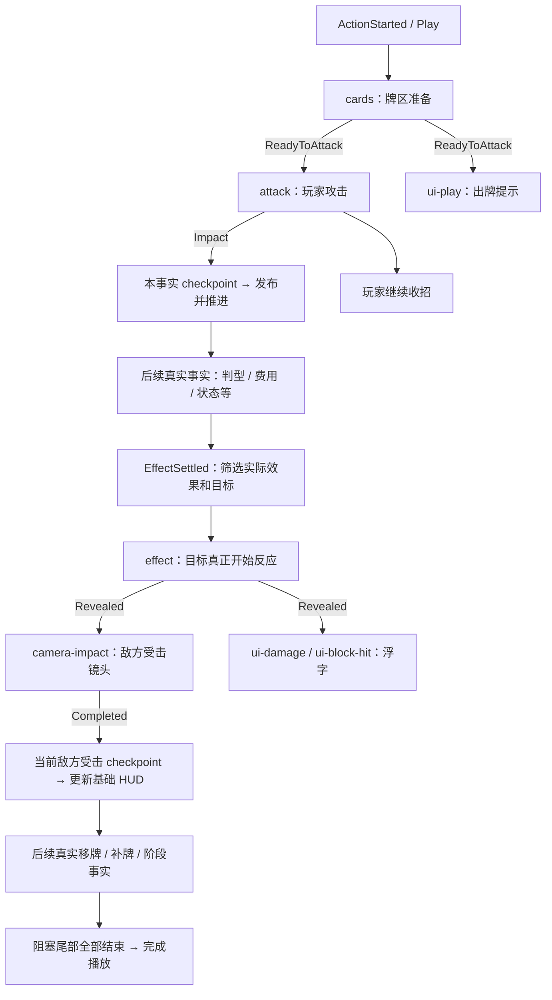

# 当前场景的表现时间线配置

日期：2026-10-18。适用场景：`Assets/Scenes/SingleBattleDemoNew.unity`。架构和恢复约定见 [实施记录](BattlePresentationImplementation.md)，规则与表现的完整设计见 [设计文档](BattlePresentationDesign.md)。

当前场景的出牌顺序完整保存在 `ScenePresentationDirector.timeline`。Host 提交规则命令、桥接不可变数据、同步牌区和基础 HUD；它不再生成 `BuildPlan`，也不调用固定的“牌区→攻击→受击”协程。

## 1. 先找到三个配置位置

| 场景位置 | 要操作的内容 |
| --- | --- |
| `Battle/Card Match` → `ScenePresentationDirector` | `targets` 绑定对象；`timeline` 定义匹配条件、节点、依赖和检查点 |
| `Battle/Card Match/Presentation Timeline` | 各个可复用动作组件：`Cards Prepare`、`Cards Settle`、`Actor Attack`、`Actor Hit`、`Camera Impact`、`UI …` 等 |
| `UI/Battle HUD/Timeline Feedback` | `Banner Template`、`Player Effect Template`、`Enemy Effect Template`；模板保持禁用，播放时克隆 |

`targets` 已绑定 `cards`、`player`、`enemy`、`camera`、`scene`、`ui.feedback`。Host 运行时另外以实际参与者 ID 绑定 Actor，因此动态目标、反伤、多目标效果不依赖“第一个敌人”。

选择动作组件可以调整它的动画参数；选择 Director 可以改变动作何时启动。两类配置职责不同。

## 2. 一次普通出牌的完整调用链

1. 玩家提交选牌。交互层进入 `Committing`，固定这次提交的牌。
2. `BattleSession` 一次性结算命令及自动流程，生成已确定的状态与有序 Timeline。表现信号不重新计算费用、伤害或发牌。
3. `BattlePresentationBridge` 将规则事实投影成 `PresentationBatch`：每条包含 `SemanticKey`、`ActorId`、目标/牌身份、`Before/After` 快照、`Values`，效果事实另有 `EffectDisplayData`。
4. `ScenePresentationDirector` 按场景里的组匹配这条事实，合并动作节点与 checkpoint；纯 C# `PresentationDirector` 调用节点的 `Play(context, markers)`。
5. 动作到达真实节点时发 marker，调度器满足依赖后启动后续动作；checkpoint 满足后，`DisplayStore` 发布该条事实的 `After` 快照，再进入下一事实。
6. 基础 HUD 和牌区同步读取显示快照；它们不会提前读取已结算到末尾的权威状态。
7. 事实全部发布且所有阻塞动作结束，整批播放完成，按最终规则状态恢复合法操作。



这个图描述当前配方。不同规则条件可能产生额外状态、遗物、反伤、死亡或自动敌人回合事实，调度器按实际序列处理。

## 3. 组、节点和检查点的字段

### 一组如何匹配事实

| 字段 | 含义 |
| --- | --- |
| `semanticKey` | 精确匹配事实名称，如 `ActionStarted`、`EffectSettled`、`CardsDealt` |
| `ruleAction` | 可选，匹配 `Values["action"]`，如 `Play`、`Discard`、`EnemyAction`；空为任意 |
| `filter` | 附加效果/身份条件；全部满足才命中 |
| `replaceDefault` | 清空此前匹配组已经组装的节点，再加入本组。名称为兼容保留，Host 中已经没有默认图 |
| `nodes` | 加入这条事实的动作节点 |
| `explicitCheckpoint` | 是否用本组 `checkpoint` 覆盖此前匹配组的检查点 |
| `checkpoint` | 控制本条快照发布、以及何时开始下一事实 |

所有命中的组按 `timeline` 数组顺序合并。后面一个 `explicitCheckpoint=True` 的组会覆盖前面的检查点，不是自动追加。

- `explicitCheckpoint=True` 且数组为空：立即发布本事实，动作可以继续作为尾部播放。
- `explicitCheckpoint=False`：沿用此前检查点。
- `replaceDefault=True` 且 `explicitCheckpoint=False`：检查点重置为等待替换后计划的阻塞节点全部完成。
- 没有显式检查点的完整计划，默认等待其中的阻塞节点。

### 一个节点如何启动

| 字段 | 含义 |
| --- | --- |
| `id` | 本条事实图内唯一的动作 ID，例如 `attack` |
| `action` | 拖入动作组件；当前提供的组件全部派生 `PresentationActionBehaviour` |
| `targetKey` | 从 `targets` 解析对象；具体动作也可使用自身引用或 DTO 解析动态目标 |
| `blocking` | 为 true 时整批播放要等待它完成。它不等于本事实的 checkpoint |
| `filter` | 节点级附加筛选 |
| `after` | 依赖列表；空表示可以立即开始，多项表示全部满足 |

每个依赖填写 `actionId`、`kind` 和可选 `marker`：

| `kind` | 何时满足 | 示例 |
| --- | --- | --- |
| `Started` | 指定节点已开始 | `attack / Started` |
| `Marker` | 指定节点实际发出标记 | `attack / Marker / Impact` |
| `Completed` | 指定动作实际完成 | `attack / Completed` |

`marker` 必须由源动作的 `Descriptor.Markers` 声明并实际发出。填一个新名字不会自动创建信号。未声明、未发出、循环依赖、重复 ID 或引用被筛掉的节点都会导致明确失败并恢复显示状态。

## 4. 当前出牌组怎么配

在 `ActionStarted / ruleAction=Play` 的主组中：

```text
filter.skipped: False
replaceDefault: false
explicitCheckpoint: true
checkpoint:
  actionId: attack
  kind: Marker
  marker: Impact
```

| `id` | `action` 组件 | `targetKey` | `after` |
| --- | --- | --- | --- |
| `cards` | `Cards Prepare` / `HandPreparationTimelineAction` | `cards` | 空 |
| `attack` | `Actor Attack` / `BattleActorTimelineAction` | 空，按事实 `ActorId` 解析 | `cards / Marker / ReadyToAttack` |

另一个同样匹配 `ActionStarted / Play / skipped=False` 的组追加：

```text
id: ui-play
action: UI Play
blocking: true
after:
  actionId: cards
  kind: Marker
  marker: ReadyToAttack
explicitCheckpoint: false
```

因此当前是牌区准备到中途，玩家攻击与“出牌”提示同时开始。要等牌区准备完全结束才攻击，只需把 `attack.after` 改成 `cards / Completed`。要让提示跟随攻击开始，可把 `ui-play.after` 改成 `attack / Started`。

`HandZoneView` 的 `selectionActionOffset / selectionActionSeconds / selectionActionReadyProgress` 控制准备动作。本场景的 ReadyToAttack 来自真实插值进度；修改该参数可以提前或推后攻击启动点。`Actor Attack.kind=Attack` 的 `Impact` 则由当前 Actor Presenter 在实际前冲命中点发出，攻击总时长等参数仍在该 Presenter 上调整。

## 5. 效果类型与目标筛选

`SceneTimelineFilter` 可放在组或节点上。所有条件为 AND，空字符串和枚举 `Any` 表示不限制。

| 字段 | 可配置值 / 语义 |
| --- | --- |
| `effectPresence` | `Any / True / False`，是否有 `EffectDisplayData` |
| `effectKind` | 精确效果名，如 `Damage / Heal / GainBlock / ClearBlock / Eliminate` |
| `healthLost`、`blockAbsorbed` | `Any / Zero / Positive`，匹配实际结算数量 |
| `healthChange`、`blockChange` | `Any / Increased / Decreased / Unchanged`，比较效果前后状态 |
| `isDeath`、`skipped` | `Any / True / False` |
| `targetId`、`actorId` | 可选稳定参与者 ID |
| `targetTeam`、`actorTeam` | 当前投影为 `player / enemy` |
| `targetRelation`、`actorRelation` | `Any / Observer / OtherThanObserver / Actor / OtherThanActor` |

目标条件优先针对 `Effect.TargetId`；无 Effect 时才看 `TargetIds`。身份、队伍、关系必须由同一个目标满足。`OtherThanObserver` 不等于敌方：多玩家模式下它也可能是另一名玩家，需要区分阵营时使用 `targetTeam`。

效果专属条件不能匹配没有 Effect 的事实，即使填写的是 `Zero`、`False` 或 `Unchanged`。仅写 `isDeath=False` 不会把一个 `ActionStarted` 当作非致死效果。

当前反应配方如下：

| 组匹配条件 | `effect` 动作 |
| --- | --- |
| `healthLost=Positive` 且 `blockAbsorbed=Zero` | `Actor Hit` |
| `blockAbsorbed=Positive` | `Actor Block Hit`，包括格挡后仍然扣血 |
| `effectKind=GainBlock` 且 `blockChange=Increased` | `Actor Gain Block` |
| `effectKind=ClearBlock` 且 `blockChange=Decreased` | `Actor Clear Block` |

这些组通常以 `effect / Marker / Revealed` 为 checkpoint。`BattleActorTimelineAction.target` 留空，动态解析效果实际目标，等该 Actor 空闲后才开始并发出 Revealed。同一组件可服务多个角色，取消旧调用不会取消后来取得该 Actor 的动作。

每个反应组还带有 `death` 节点：节点筛选 `isDeath=True`，依赖 `effect / Completed`。无扣血、无格挡变化且直接死亡的情况使用独立死亡组，避免引用根本不存在的 `effect`。

## 6. 敌人受击后，镜头与 UI 如何触发

当前敌方命中镜头有两个互斥组，都匹配 `EffectSettled`、`targetTeam=enemy`：

- 真实扣血且没有吸收格挡：`healthLost=Positive / blockAbsorbed=Zero`。
- 实际吸收格挡：`blockAbsorbed=Positive`。

它们追加同一个配置形状：

```text
nodes:
  id: camera-impact
  action: Camera Impact / TransformTimelineAction
  targetKey: camera
  blocking: true
  after:
    actionId: effect
    kind: Marker
    marker: Revealed

explicitCheckpoint: true
checkpoint:
  - actionId: effect
    kind: Marker
    marker: Revealed
  - actionId: camera-impact
    kind: Completed
```

镜头组件 `steps` 当前为两段：0.045 秒轻微旋转到峰值，发出 `Peak`；0.1 秒回原位，发出 `Settled`。`restoreOnComplete=True` 保证完成和取消都恢复原姿态。位移、旋转、缩放、每段时长和标记都可以修改。

浮字属于独立节点。比如敌人扣血组匹配 `healthLost=Positive / targetTeam=enemy`，追加 `ui-damage`，依赖 `effect / Marker / Revealed`，并保持 `explicitCheckpoint=False`。它与镜头同时开始，之后可继续淡出。

若要让这条敌方伤害浮字晚到镜头峰值才出现，可以在其 `after` 中增加 `camera-impact / Marker / Peak`。只修改命中同一镜头组的敌方节点；玩家受伤组没有 `camera-impact`，不能引用它。

当前镜头检查点等待镜头完成，因此基础血条数值在约 0.145 秒的镜头动作结束后发布。这样连续、多目标伤害不会同时写同一镜头 Transform。若改成只等 `effect.Revealed`，HUD 会提前到受击开始时更新，但需要另行处理跨事实的镜头重叠；当前 `TransformTimelineAction` 对并发占用会报 `TargetBusy`，不会暗中覆盖别的镜头动作。

### 跨事实信号边界

`attack` 在 `ActionStarted` 图内，`effect` 在后面的 `EffectSettled` 图内。不能在效果组写 `attack / Marker / Impact`。正确连接为：

```text
ActionStarted 的 attack.Impact
→ 满足本事实 checkpoint
→ 依序显示后续实际事实
→ EffectSettled 匹配真实目标与效果
→ effect.Revealed
→ 镜头 / 受击浮字
```

同一事实的多个匹配组可以相互引用节点，但不同事实之间只通过有序事实推进与各自 checkpoint 衔接。

## 7. 基础 HUD 与额外 UI 动画

基础 HUD 的血量、格挡、能量、牌数等读取 `host.Display`。对应事实的 checkpoint 满足后，调用链是：

```text
DisplayStore.Apply
→ Host.DisplayChanged
→ StateChanged
→ SingleBattleHud.Refresh
```

额外 UI 使用 `UiFeedbackTimelineAction`，读取此次事实的不可变 DTO。它可以在基础 HUD 更新前显示准备提示，也可以通过依赖延后显示结果；它不修改显示快照或权威状态。`Revealed` 在文字首个可见帧发出，`Completed` 在淡出结束时完成。

| UI 动作字段 | 用途 |
| --- | --- |
| `template` | 禁用的 TMP 模板；每次播放克隆独立实例 |
| `outputRoot` | 克隆实例的父 RectTransform |
| `kind` | `Custom / Action / Hand / Cost / Damage / Block / Heal / Feedback / Phase / Result` |
| `textTemplate` | 可选文本覆盖与数据 token |
| `tint`、`seconds` | 颜色和总时长 |
| `fadeInFraction`、`fadeOutFraction` | 淡入淡出占比 |
| `rise`、`initialScale` | 上浮距离与初始缩放 |
| `concurrentSpacing` | 同模板并发文字的间距 |

当前模板复制既有 HUD 字体并使用 UI layer；反馈根与文字均不接收射线。多个动作共享同模板时分配不同文字位置。同步、重开、禁用或取消会清除旧实例；空白文本直接发出 Revealed 并完成，不留下不可见等待。

常用 token：

| token | 数据来源 |
| --- | --- |
| `{action}`、`{actor}`、`{target}` | 命令名、行动者名、实际目标名 |
| `{pattern}`、`{score}`、`{points}`、`{multiplier}` | 本条事实的判型/计分 Values |
| `{cost}`、`{feedback}` | 本条费用与状态/遗物文字 |
| `{amount}` | 实际效果的 SettledAmount |
| `{damage}` / `{healthLost}` | 实际扣血 |
| `{block}` | 优先显示吸收格挡，否则显示格挡前后差值 |
| `{heal}` | 实际增加的生命值 |
| `{round}`、`{displayRound}`、`{phase}`、`{result}` | 显示状态；displayRound 为面向玩家的回合编号 |
| `{value:键}` | 任意中性 Values 项 |
| `{before:target.health}`、`{after:target.health}` | 目标前后生命值 |
| `{after:actor.energy}`、`{after:observer.discards}` | 行动者属性或观察者资源 |
| `{after:标签名}` | 显示快照 Labels |

示例：`{target} -{damage}`、`格挡抵消 {block}`、`{pattern} · {score}`。字段是否存在取决于事实类型；不要在 `ActionStarted` 上要求读取尚未提供的伤害 Effect。未知 token 原样保留，便于发现拼写错误。

当前 UI 覆盖开战、出牌确认、判型、费用、阶段开始/结束、实际伤害/格挡变化、实际治疗、状态、遗物与战斗结果。治疗组使用 `effectKind=Heal / healthChange=Increased`，满血未回血不播 `+0`。

## 8. 移牌、发牌与完成门禁

`CardsMoved / CardsDealt / DeckRecycled` 配置 `cards-settle / HandSettleTimelineAction`，`explicitCheckpoint=True` 且 checkpoint 为空。先发布真实 CardList，再在下一帧等待该次投影产生的手牌运动完成。

`cards-settle` 不决定抽哪些牌，也不移动规则卡牌；它只等待已有 HandZoneView 的真实过渡。手牌准备的临时偏移仍由 `HandPreparationTimelineAction` 管理，取消时只撤销自己的贡献，不恢复过时布局。

当前各主要动作均为 blocking。checkpoint 可以提前推进下一事实，整批输入门禁仍等待所有阻塞尾部完成。把节点设为 `blocking=False` 会允许它在整批完成后继续播放，直到完成或被下一批/同步取消；应只用于不承担输入安全责任的装饰尾部。

## 9. 接入新场景与更换实现

菜单 `工具 > 卡牌战斗 > 表现时间线 > 接入当前场景` 会调用编辑器 `BattlePresentationSceneSetup.ConfigureHost` 并保存当前场景。首次把旧空组迁移成完整配方，原有非空组按既有追加/替换语义保留。已经生成配方的场景再次执行不会覆盖设计者修改的顺序与动作参数。

编辑器 API：

```csharp
BattlePresentationSceneSetup.ConfigureHost(host);
// 明确重建当前编辑器配方（会替换配置）：
BattlePresentationSceneSetup.ConfigureHost(host, replaceExisting: true);
// 无 Canvas 的测试场景可只构建牌区和角色配方：
BattlePresentationSceneSetup.ConfigureHost(host, includeFeedback: false);
```

这是编辑器建场景工具，不是运行时自动默认逻辑。运行场景必须保存有效 timeline；Host 在缺少配置时会报错。

新 Unity 动作派生 `BattlePresentation.Unity.PresentationActionBehaviour`，实现 `Descriptor / Play / Synchronize`。`Play` 只消费 `ActionContext` 的中性数据和对象绑定，返回真实操作句柄，通过 `IMarkerSink` 发出已声明的信号。基础类提供 `StartRoutine`、可注入的 `StartPresentationRoutine` 和 `DeltaTimeProvider`，既可运行在 Unity，也可用确定性的测试时钟驱动。

动作只拥有自身的临时视觉与资源通道；取消必须关闭旧回调并释放自己的对象，Synchronize 应无动画地收敛到快照。可以为 2D 卡牌、3D 角色、UI、粒子、音效或其他对象写适配器，不需要修改规则层或把具体对象塞进规则事实。

验证入口与最终结果见 [实施记录](BattlePresentationImplementation.md#验证入口与报告) 和 [验证记录](Validation/2026-10-18-battle-presentation.md)。
